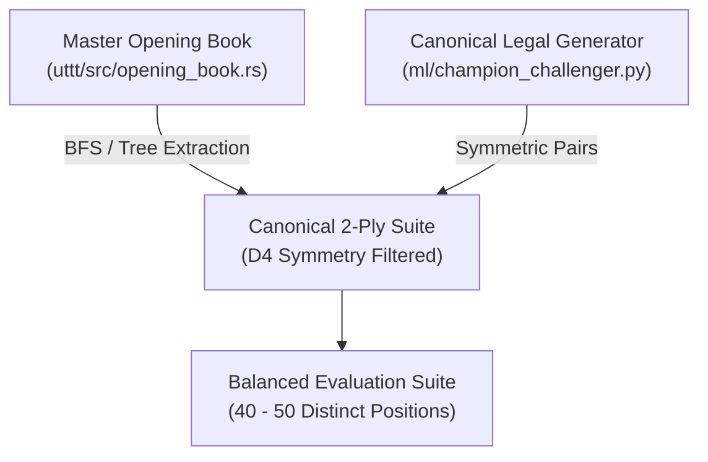

# AlphaZero Tournament & Gating Specification
**Ultimate Tic-Tac-Toe Autonomous Evaluation & Promotion Protocol**
*Document Version: 1.0.0 | Status: Active Specification*

---

## 1. Executive Summary & Objective

In reinforcement learning and AlphaZero self-play engines, continuous autonomous training loops must accurately determine whether a newly trained candidate model ("Challenger") is strictly superior to the current best model ("Champion") before promoting it.

A naive head-to-head match (e.g., playing $N$ games directly from the standard empty starting board with deterministic move selection) exhibits **catastrophic evaluation failure**:
1. **Deterministic Duplication:** When Dirichlet exploration noise is disabled ($\epsilon = 0$) and temperature is zero ($T = 0$), two deterministic bots playing from an identical starting board will play the **exact same move trajectory every single time**. A match of 24 games degenerates into a single game played 24 times.
2. **First-Move Advantage (P1 Bias):** In Ultimate Tic-Tac-Toe, Player 1 (X) commands an inherent structural advantage (statistically 55%–65% win rate between evenly matched engines). If color alternation is not paired with identical board states, one model will be unfairly penalized by playing more games as Player 2 (O).
3. **Small-Sample False Promotion Rate (Type I Error):** At small sample sizes (e.g., $N = 24$), random variation allows an identical or inferior model to reach a $55\%$ win rate with over $27\%$ probability ($p = 0.2706$).

This document formally specifies the **standardized 2-Ply Opening Suite**, **Color-Alternating Pair Protocol**, and **Sequential Probability Ratio Test (SPRT) Gating Criteria** mandated across both the pure Rust engine (`uttt/src/opening_book.rs`, `uttt/src/bin/arena.rs`) and the Python training pipeline (`ml/champion_challenger.py`).

---

## 2. The 2-Ply Opening Suite Protocol

### 2.1 Why 2 Plies?
In Ultimate Tic-Tac-Toe, ply 0 is the empty board. 
- **Ply 1:** Player 1 (X) plays move $m_1 = (sb_1, sq_1)$, sending Player 2 to subboard $sb_2 = sq_1$.
- **Ply 2:** Player 2 (O) plays reply $m_2 = (sb_2, sq_2)$, sending Player 1 to subboard $sb_3 = sq_2$.

At Ply 2, the game enters its first substantive tactical branching point:
- Both Player 1 and Player 2 have claimed one cell in different subboards.
- Player 1 (X) is to move, facing an open or targeted subboard dictated by Player 2's reply.
- No subboard is yet won, preserving full strategic freedom across all 9 subboards while breaking the symmetry of the empty starting state.

### 2.2 Canonical Opening Generation
To avoid introducing subjective bias or narrow opening traps, opening positions are generated through two synchronized pipelines:

1. **Rust Engine (`OpeningBook::extract_opening_suite`):**
   - Harvests all 2-ply positions reached in high-visit master games ($\ge 5,000$ MCTS visits).
   - Filters duplicate positions under the 8 dihedral symmetries of the $D_4$ group via `SymmetryEngine::canonical_form`.
   - Produces a deterministic, cached suite of distinct legal positions.
2. **Python Pipeline (`build_2ply_opening_suite`):**
   - Generates the complete matrix of canonical first moves (Center $sb=4$, Corner $sb \in \{0, 2, 6, 8\}$, Edge $sb \in \{1, 3, 5, 7\}$) paired with representative opponent replies.
   - Ensures balanced representation of center, corner, and edge tactical initiations.

---

## 3. Color-Alternating Pair Evaluation

To completely neutralize first-move advantage and ensure identical tactical conditions:

### 3.1 Pairwise Symmetry Rule
For every opening position $P_k$ in the suite ($k \in \{1, \dots, K\}$), exactly **two games** are played:
$$\text{Game } 2k-1: \quad \text{Player 1 (X)} = \text{Challenger}, \quad \text{Player 2 (O)} = \text{Champion}$$
$$\text{Game } 2k: \quad \text{Player 1 (X)} = \text{Champion}, \quad \text{Player 2 (O)} = \text{Challenger}$$

### 3.2 Cancellation of State Bias
Let $V(P_k)$ be the inherent value of position $P_k$ to the first player.
- In Game $2k-1$, Challenger receives $+V(P_k)$.
- In Game $2k$, Champion receives $+V(P_k)$.
- The net difference in match score over the pair depends **solely on which agent navigates the position better**, completely canceling out $V(P_k)$:
$$\Delta \text{Score}_k = \text{Score}_{\text{Challenger}}(P_k) - \text{Score}_{\text{Champion}}(P_k)$$

---

## 4. Statistical Rigor & Gating Criteria

### 4.1 Scoring System
In compliance with international chess and CodinGame contest rules:
$$\text{Points} = W + 0.5 \times D$$
$$\text{Win Rate } \hat{p} = \frac{W + 0.5 D}{N}$$
where $W$ is wins, $D$ is draws, and $N = W + L + D$ is total games.

### 4.2 False Promotion Analysis (Type I Error)
Under the null hypothesis $H_0$ that the Challenger has identical playing strength to the Champion ($p = 0.5$):

| Match Size $N$ | Threshold | Critical Score | $P(\text{False Promotion})$ (Type I Error) |
|---|---|---|---|
| $N = 24$ (12 pairs) | $\ge 55.0\%$ | $\ge 13.5$ pts | **$27.06\%$** (Unacceptable) |
| $N = 40$ (20 pairs) | $\ge 55.0\%$ | $\ge 22.0$ pts | **$18.41\%$** (Marginal) |
| $N = 80$ (40 pairs) | $\ge 55.0\%$ | $\ge 44.0$ pts | **$8.92\%$** (Good) |
| $N = 120$ (60 pairs) | $\ge 55.0\%$ | $\ge 66.0$ pts | **$4.18\%$** (Statistically Rigorous) |

> [!IMPORTANT]
> **Mandatory Threshold:** A minimum match size of **$N = 40$ games (20 opening pairs)** is required for routine self-play iteration, and **$N \ge 80 - 120$ games** is mandated for formal milestone promotions.

### 4.3 Sequential Probability Ratio Test (SPRT)
For continuous autonomous training pipelines, Wald's SPRT provides optimal sample efficiency:
- $H_0: \text{Elo difference} \le 0$ ($p \le 0.50$)
- $H_1: \text{Elo difference} \ge +35$ ($p \ge 0.55$)
- Error bounds: $\alpha = 0.05$ (Type I), $\beta = 0.05$ (Type II).
- Log-Likelihood boundaries:
  $$A = \ln\left(\frac{1 - \beta}{\alpha}\right) = \ln\left(\frac{0.95}{0.05}\right) = +2.944 \quad (\text{Promote})$$
  $$B = \ln\left(\frac{\beta}{1 - \alpha}\right) = \ln\left(\frac{0.05}{0.95}\right) = -2.944 \quad (\text{Reject / Defend})$$

Pairs of games are evaluated sequentially. The match halts immediately when the log-likelihood ratio crosses boundary $A$ or $B$, cutting average evaluation games by up to 50% on decisive matchups.

---

## 5. CodinGame Contest Tiebreaker Synchronization

When a game reaches 81 played plies or both players have no legal moves with neither achieving 3 subboards in a row:
1. **Contest Metric:** The winner is decided by **total won mini-boards**:
   $$\Delta_{\text{mini}} = |M_X| - |M_O|$$
2. **Outcome Assignment:**
   - If $|M_X| > |M_O|$: Player 1 (X) wins ($V = +1.0$).
   - If $|M_O| > |M_X|$: Player 2 (O) wins ($V = -1.0$).
   - If $|M_X| == |M_O|$: Exact draw ($V = 0.0$).
3. **Cross-Language Consistency:** Both `ml/dataset.py`, `ml/champion_challenger.py`, and `uttt/src/uttt_trait_solving.rs` strictly enforce this tiebreak rule.

---

## 6. Verification and Integration Matrix

| Component | File Path | Implementation Status |
|---|---|---|
| Opening Suite Extraction | `uttt/src/opening_book.rs` | Operational (`extract_opening_suite`) |
| Tournament Pairing & Alternation | `uttt/src/bin/arena.rs` | Operational (`--openings --opening-depth 2`) |
| Python 2-Ply Suite Generator | `ml/champion_challenger.py` | Operational (`build_2ply_opening_suite`) |
| Python Match Evaluator | `ml/champion_challenger.py` | Operational (`play_eval_match`) |
| Dynamic Runtime INT8 Reloading | `uttt/src/nn/mod.rs` | Operational (`ModelInt8::from_file`) |
| Live Telemetry Streaming | `ml/champion_challenger.py` | Operational (`ml/training_status.json`) |
| Web Dashboard Integration | `uttt-frontend/src/main.rs` | Operational (`http://0.0.0.0:8080/api/training/status`) |
