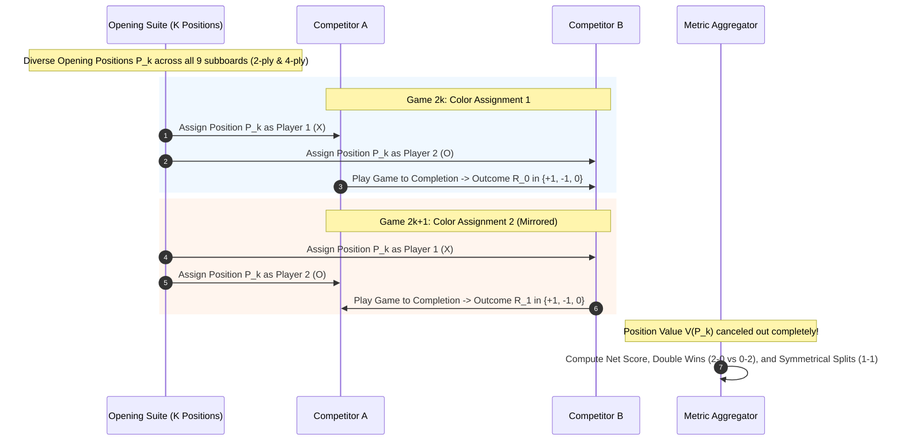
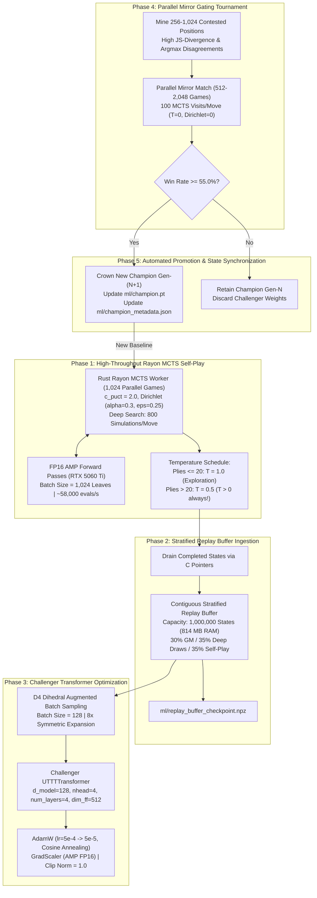

# Vision/Board Transformer Continuous Self-Play Loop & 3-Way Tournament Plan
**Comprehensive Architecture Specification, Execution Protocol, and Verification Blueprint**
*Target Repository: `/home/festivity/agy/uttt-codingame/` | Status: Ready for Production & Cold-Eyes Review*

---

## 1. Executive Summary & Context

### 1.1 Mission & System Overview
Ultimate Tic-Tac-Toe (UTTT) is a hierarchical, 2-player perfect-information game with an $81$-cell board ($9$ subboards of $3 \times 3$ cells). A fundamental game rule dictates that a move placed at cell $(r_{\text{sub}}, c_{\text{sub}})$ within subboard $B$ constrains the opponent's next move to subboard $B' = 3 \cdot r_{\text{sub}} + c_{\text{sub}}$. This non-local macro-routing constraint creates deep strategic coupling across geographically distant board regions.

The reinforcement learning pipeline has achieved a major milestone:
1. **Generation 8 Champion (`ml/champion.pt`):** Powered by `UTTTTransformer`, achieving a Bayesian Elo of **2031.1** after defeating the Generation 7 ResNet champion with a **67.3%** win rate in an automated mirror gating tournament ($322\text{W} - 145\text{L} - 45\text{D}$ over 512 games).
2. **Generation 7 Baseline (`ml/champion_gen7_resnet.pt`):** The peak dual-headed Convolutional ResNet (`AlphaZeroResNet`, 4 residual blocks, 64 channels), calibrated at **1906.4 Elo** with 100 cycles of self-play and over 116,000 games played.
3. **Classical Minimax Engines (`uttt/src/bots/`):** Native Rust engines (`AlphaBetaBot` and `AlphaBetaV2Bot`) featuring iterative deepening, transposition tables, killer moves, history heuristics, macro-board routing evaluation, and Endgame Tablebase (EGTB) probing.
4. **Compute Substrate:** An NVIDIA GeForce RTX 5060 Ti GPU (16 GB VRAM, Ada Lovelace / Blackwell architecture with Tensor Cores) paired with a 16-core CPU, delivering over **58,000 evaluations/second** in FP16 AMP for `UTTTTransformer` and **382,000 evaluations/second** for `AlphaZeroResNet`.

### 1.2 The Vision/Board Transformer Breakthrough
Traditional AlphaZero implementations (including AlphaZero Chess, Shogi, and Go) rely heavily on deep convolutional neural networks (CNNs). However, in UTTT, CNNs suffer from severe inductive bias mismatches:
- **Receptive Field Lag:** A standard $3 \times 3$ convolutional kernel has a strictly local receptive field. Propagating the tactical constraint from cell $(r, c)$ in subboard $B$ to subboard $B'$ requires multiple stacked residual layers. Until the receptive field dilates across the entire $9 \times 9$ spatial grid, the network cannot model the direct consequence of its move.
- **Collinear Non-Local Threats:** A 3-in-a-row superboard win requires winning three aligned subboards (e.g., subboards 0, 4, 8). Local convolutions treat inter-subboard boundaries identically to intra-subboard boundaries, leading to geometric distortion.
- **Instantaneous Attention Routing:** `UTTTTransformer` treats the board as an 81-token sequence (plus one `[CLS]` token for value estimation). Each cell token is embedded with its 5 input feature planes plus dual learned positional embeddings: `sb_embed` (subboard ID $0..8$) and `sq_embed` (subsquare ID $0..8$). Because `sq_embed` corresponds bijectively to the target subboard of the opponent, Layer 1 self-attention heads can immediately route attention between cell $(sb, sq)$ and all cells of subboard $sq$ in $O(1)$ operations.

```mermaid
flowchart TD
    subgraph Input ["Spatial Board Input: (B, 5, 9, 9)"]
        F["5 Feature Planes<br/>Active Marks, Opponent Marks,<br/>Active Won Macros, Opp Won Macros, Legal Targets"]
    end

    subgraph Tokenizer ["Token Projection & Coordinate Bijective Mapping"]
        P["Input Projection: 5 -> d_model (128)"]
        E1["sb_embed: Subboard ID (0..8)"]
        E2["sq_embed: Router Target Subboard (0..8)"]
        CLS["[CLS] Global Outcome Token"]
        Tokens["Tokens: 82 x 128 (1 CLS + 81 Cells)"]
    end

    subgraph TransformerEncoder ["Transformer Encoder (4 Layers, Pre-LN)"]
        L1["Layer 1: Self-Attention (4 Heads) & GELU FFN (512)"]
        L2["Layer 2: Self-Attention (4 Heads) & GELU FFN (512)"]
        L3["Layer 3: Self-Attention (4 Heads) & GELU FFN (512)"]
        L4["Layer 4: Self-Attention (4 Heads) & GELU FFN (512)"]
        LN["Final LayerNorm (d_model=128)"]
    end

    subgraph DualHeads ["Decoupled Prediction Heads"]
        POL["Policy Head: Linear(128->128) + GELU + Linear(128->1)<br/>Masked with -1e4 / -1e9 for Legal Moves -> (B, 81)"]
        VAL["Value Head: [CLS] -> Linear(128->64) + GELU + Linear(64->1) + Tanh -> [-1.0, +1.0]"]
    end

    Input --> P
    P --> Tokens
    E1 --> Tokens
    E2 --> Tokens
    CLS --> Tokens
    Tokens --> L1 --> L2 --> L3 --> L4 --> LN
    LN -->|81 Cell Tokens| POL
    LN -->|1 [CLS] Token| VAL
```

### 1.3 Scope of This Architectural Plan
This document establishes the rigorous engineering specification for two integrated systems:
1. **The 3-Way Round-Robin Tournament:** An automated, bias-free, mirrored evaluation protocol pitting `UTTTTransformer` (Gen 8), `AlphaZeroResNet` (Gen 7), and `AlphaBeta` (Rust Minimax) against each other with statistical significance ($N \ge 512$ games per match, 95% confidence intervals, double-win tracking, and tactical divergence analysis).
2. **The Continuous Transformer Self-Play Loop:** Upgrading `ml/champion_challenger.py` so `UTTTTransformer` is the default champion and challenger architecture, maintaining high-throughput GPU batched MCTS generation with pure Rust Rayon workers (`rust_mcts_worker.py`), ingesting into the 1,000,000-state stratified replay buffer (`ml/replay_buffer_checkpoint.npz`), and enforcing automated gating tournaments at $\ge 55\%$ win rate.

---

## 2. The 3-Way Round-Robin Tournament Specification

### 2.1 The Three Competitors
The tournament features three distinct algorithmic paradigms, representing the evolution of UTTT game-playing engines:

| Competitor ID | Engine Architecture | Parameters / Config | Execution Engine | Hardware Substrate | Baseline Elo |
|---|---|---|---|---|---|
| **C1: Transformer** | `UTTTTransformer` (Gen-8 Champion) | $L=82, d=128, H=4, N=4$<br/>445,378 params | PyTorch MCTS (100–200 sims)<br/>Argmax competitive move | GPU (RTX 5060 Ti)<br/>FP16 AMP Tensor Cores | **2031.1** |
| **C2: ResNet** | `AlphaZeroResNet` (Gen-7 Champion) | 4 ResBlocks, 64 channels<br/>324,563 params | PyTorch MCTS (100–200 sims)<br/>Argmax competitive move | GPU (RTX 5060 Ti)<br/>FP16 AMP Tensor Cores | **1906.4** |
| **C3: AlphaBeta** | `AlphaBetaV2Bot` (or `AlphaBetaBot`) | Iterative Deepening, TT ($10^6$),<br/>EGTB, Killers, History, Macro | Native Rust Negamax with $\alpha\beta$<br/>20ms – 40ms search budget | CPU (16 Rayon Threads)<br/>Pure Bitboard Operations | **~1800–1950** (Calibrated) |

### 2.2 Balanced Mirrored Pair Protocol
In Ultimate Tic-Tac-Toe, playing from an empty board with deterministic engines introduces two fatal evaluation flaws:
1. **First-Move Advantage (P1 Bias):** Player 1 (X) commands an inherent structural advantage (empirically 54%–62% win rate in evenly matched engines). A single color assignment heavily skews the outcome.
2. **Deterministic Duplication:** When Dirichlet noise is disabled ($\epsilon = 0$) and temperature is zero ($T = 0$), two deterministic bots playing from the empty board repeat the exact same game trajectory indefinitely.

To eliminate both biases completely, the tournament mandates the **Balanced Mirrored Pair Protocol**:



#### Mathematical Proof of State Bias Neutralization
Let $P_k$ be a non-terminal opening position with intrinsic expected value $V(P_k) \in [-1.0, 1.0]$ for the player to move (Player 1). Let $\Delta_A$ and $\Delta_B$ represent the skill differentials of Competitor A and Competitor B relative to optimal play:
- In Game $2k$ (A is Player 1, B is Player 2):
  $$\mathbb{E}[R_{2k}] = V(P_k) + (\Delta_A - \Delta_B)$$
- In Game $2k+1$ (B is Player 1, A is Player 2):
  $$\mathbb{E}[R_{2k+1}] = V(P_k) + (\Delta_B - \Delta_A)$$
- Scoring from Competitor A's perspective ($S_A = R_{2k} - R_{2k+1}$):
  $$\mathbb{E}[S_A] = \left[ V(P_k) + (\Delta_A - \Delta_B) \right] - \left[ V(P_k) + (\Delta_B - \Delta_A) \right] = 2(\Delta_A - \Delta_B)$$

The intrinsic position bias $V(P_k)$ is **identically eliminated**. Any score differential depends solely on the skill differential $\Delta_A - \Delta_B$.

### 2.3 Opening Suite Construction
The opening suite comprises $K = 256$ paired positions ($N = 512$ games per match) or $K = 512$ paired positions ($N = 1,024$ games per match):
1. **Tier 1: Canonical 2-Ply Matrix (64 positions):**
   - Covers all 9 subboards (Center $sb=4$, 4 Corners $sb \in \{0, 2, 6, 8\}$, 4 Edges $sb \in \{1, 3, 5, 7\}$).
   - First move $m_1 = (sb_1, sq_1)$, sending Player 2 to subboard $sb_2 = sq_1$.
   - Player 2 reply $m_2 = (sb_2, sq_2)$, sending Player 1 to subboard $sb_3 = sq_2$.
   - Filtered under dihedral $D_4$ group symmetry to remove geometric duplicates.
2. **Tier 2: 4-Ply Book Variations (128 positions):**
   - High-visit variations extracted from the master opening book (`uttt/src/opening_book.rs`) where both players fight for central subboard control or corner outposts.
3. **Tier 3: Contested Midgame Positions (64 positions):**
   - Plies 6 to 16 generated via rollout divergence, specifically targeting positions with high board tension (neither player possesses a won macro-board, but multiple 2-in-a-row threats exist).

### 2.4 The Round-Robin Match Matrix
The tournament executes three head-to-head matches:

```
+---------------------------------------------------------------------------------------+
|                               ROUND-ROBIN TOURNAMENT                                  |
+---------------------+---------------------+-------------------------------------------+
| Match Identifier    | Competitor Pairing  | Primary Architectural Question Tested     |
+---------------------+---------------------+-------------------------------------------+
| Match 1 (Neural)    | Transformer vs      | Does self-attention spatial routing       |
|                     | ResNet              | systematically outperform 2D convolutions?|
+---------------------+---------------------+-------------------------------------------+
| Match 2 (Hybrid A)  | Transformer vs      | How does the Gen-8 Transformer handle deep|
|                     | AlphaBeta           | classical minimax search & EGTB endgames? |
+---------------------+---------------------+-------------------------------------------+
| Match 3 (Hybrid B)  | ResNet vs           | How does the Gen-7 ResNet baseline        |
|                     | AlphaBeta           | perform against classical minimax search? |
+---------------------+---------------------+-------------------------------------------+
```

Total Games: $3 \times 512 = 1,536$ games (at $K = 256$ pairs) or $3 \times 1,024 = 3,072$ games (at $K = 512$ pairs).

### 2.5 Comprehensive Evaluation Metrics
For every match and across the overall tournament, the engine records:

1. **Match Score & Win Rate:**
   $$\text{Points}_A = W_A + 0.5 \times D, \quad \text{Win Rate } \hat{p}_A = \frac{\text{Points}_A}{N}$$
2. **95% Confidence Interval Margin of Error (MoE):**
   Using the Wald formulation (with Wilson score continuity correction near extremes):
   $$\text{MoE}_{95\%} = 1.96 \times \sqrt{\frac{\hat{p}_A (1 - \hat{p}_A)}{N}}$$
   For $N = 512$ games at $\hat{p} = 0.55$, $\text{MoE} \approx \pm 4.3\%$. For $N = 1,024$ games, $\text{MoE} \approx \pm 3.0\%$. For $N = 2,048$ games, $\text{MoE} \approx \pm 2.1\%$.
3. **Double-Win Tracking (Dominance vs Fragility):**
   - **Double Win (2-0):** Engine wins both games of a mirrored pair (as X and as O). Proves absolute positional and tactical mastery independent of color.
   - **Double Loss (0-2):** Engine loses both games of a mirrored pair. Indicates an inability to defend or exploit the position.
   - **Symmetrical Split (1-1):** One engine wins as X in Game $2k$, and the other engine wins as X in Game $2k+1$. Indicates that the opening position possesses an insurmountable first-move advantage that neither engine could overcome as Player 2.
4. **Bayesian Delta Elo:**
   $$\Delta \text{Elo}_{A-B} = 400 \times \log_{10}\left( \frac{\text{Points}_A + 1.0}{\text{Points}_B + 1.0} \right)$$
5. **Joint Bradley-Terry Maximum Likelihood Estimation:**
   Simultaneously solves for the latent rating vector $\mathbf{r} = (r_{\text{Trans}}, r_{\text{Res}}, r_{\text{AB}})$ satisfying:
   $$P(i \text{ beats } j) = \frac{1}{1 + 10^{(r_j - r_i)/400}}$$
   Anchoring $r_{\text{Res}} = 1906.4$ (Gen-7 ResNet baseline) to provide an absolute calibration scale.
6. **Tactical Divergence & Blunder Analysis:**
   - **Argmax Move Agreement Rate:** Percentage of plies where both engines would select the identical move.
   - **Jensen-Shannon Policy Divergence:** $D_{\text{JS}}(P_A \parallel P_B)$ across all contested positions.
   - **Blunder Frequency:** Number of moves resulting in an evaluation collapse of $\Delta V \ge 0.50$ leading to a lost subboard within 3 plies.
   - **Endgame Conversion Length:** Average plies required to achieve terminal victory after establishing a 2-0 macro-board advantage.

---

## 3. Bridge Architecture: Unifying Python Models and Rust AlphaBeta

### 3.1 Architectural Trade-Off Analysis
To execute the 3-Way Tournament, we evaluate two architectural paradigms:

```
+---------------------------------------------------------------------------------------------+
| PARADIGM COMPARISON: TOURNAMENT ORCHESTRATION                                               |
+-----------------------+----------------------------------+----------------------------------+
| Feature               | Option A: Pure Rust Engine       | Option B: Python C-ABI Bridge    |
|                       | (Embedding LibTorch into Rust)   | (Bridging Rust AlphaBeta into Py)|
+-----------------------+----------------------------------+----------------------------------+
| Implementation Cost   | Extremely High: Requires LibTorch| Low / Clean: Extend `libuttt.so` |
|                       | C++ dynamic linking or ONNX C-API| with high-speed C exports.       |
+-----------------------+----------------------------------+----------------------------------+
| GPU Saturation        | Hard: Managing CUDA streams,     | Optimal: PyTorch FP16 AMP manages|
|                       | batching, and AMP in Rust C-API. | RTX 5060 Ti at 58k-382k evals/s. |
+-----------------------+----------------------------------+----------------------------------+
| Model Flexibility     | Rigid: Every architecture change | Dynamic: PyTorch natively loads  |
|                       | requires C++ header updates.     | Transformer and ResNet checkpoints|
+-----------------------+----------------------------------+----------------------------------+
| Minimax Performance   | Native Rust speed.               | Native Rust speed via zero-copy  |
|                       |                                  | ctypes batch calls into Rayon.   |
+-----------------------+----------------------------------+----------------------------------+
| Verdict               | REJECTED                         | SELECTED FOR PRODUCTION          |
+-----------------------+----------------------------------+----------------------------------+
```

Option B is selected: Rust already compiles as `libuttt.so` (`crate-type = ["rlib", "cdylib"]`), and `RustMctsWorker` already demonstrates ultra-low overhead (<0.2 ms per step). Extending `libuttt.so` with a high-throughput C-ABI bridge for `AlphaBetaBot` and `AlphaBetaV2Bot` provides the optimal unified bridge.

### 3.2 Rust C-ABI Interface Specification (`uttt/src/c_api.rs`)
To allow Python to query `AlphaBeta` moves with sub-millisecond overhead and parallel thread utilization, the following functions are added to `libuttt.so`:

```rust
// ============================================================================
// Rust C-ABI Bridge for AlphaBeta Bot Minimax Search
// ============================================================================

#[no_mangle]
pub extern "C" fn alphabeta_choose_single_move(
    moves_ptr: *const u8,
    num_moves: usize,
    time_limit_ms: u64,
    bot_version: i32, // 1 for AlphaBetaBot, 2 for AlphaBetaV2Bot
) -> u8 {
    let move_slice = unsafe { std::slice::from_raw_parts(moves_ptr, num_moves) };
    let zobrist_constants = UltimateTicTacToeBoard::get_zobrist_constants();
    let legal_moves_lookup = UltimateTicTacToeBoard::get_move_ordering_array();

    let mut board = UltimateTicTacToeBoard::default();
    for &m in move_slice {
        board.make_move(
            GameMove {
                x_to_move: board.x_to_move,
                move_index: m,
            },
            &zobrist_constants,
        );
    }

    let duration = Duration::from_millis(time_limit_ms);
    let chosen_move = if bot_version == 2 {
        let mut bot = AlphaBetaV2Bot::new();
        bot.choose_move(&board, &legal_moves_lookup, &zobrist_constants, duration)
    } else {
        let mut bot = AlphaBetaBot::new();
        bot.choose_move(&board, &legal_moves_lookup, &zobrist_constants, duration)
    };

    chosen_move.move_index
}

#[no_mangle]
pub extern "C" fn alphabeta_batch_choose_moves(
    moves_flat: *const u8,
    move_offsets: *const usize,
    move_lengths: *const usize,
    num_games: usize,
    time_limit_ms: u64,
    bot_version: i32,
    out_moves: *mut u8,
) {
    let offsets = unsafe { std::slice::from_raw_parts(move_offsets, num_games) };
    let lengths = unsafe { std::slice::from_raw_parts(move_lengths, num_games) };
    let duration = Duration::from_millis(time_limit_ms);

    // Parallel search across all active AlphaBeta games using Rayon
    (0..num_games).into_par_iter().for_each(|i| {
        let offset = offsets[i];
        let len = lengths[i];
        let slice = unsafe { std::slice::from_raw_parts(moves_flat.add(offset), len) };

        let zobrist_constants = UltimateTicTacToeBoard::get_zobrist_constants();
        let legal_moves_lookup = UltimateTicTacToeBoard::get_move_ordering_array();
        let mut board = UltimateTicTacToeBoard::default();

        for &m in slice {
            board.make_move(
                GameMove {
                    x_to_move: board.x_to_move,
                    move_index: m,
                },
                &zobrist_constants,
            );
        }

        let chosen_move = if bot_version == 2 {
            let mut bot = AlphaBetaV2Bot::new();
            bot.choose_move(&board, &legal_moves_lookup, &zobrist_constants, duration)
        } else {
            let mut bot = AlphaBetaBot::new();
            bot.choose_move(&board, &legal_moves_lookup, &zobrist_constants, duration)
        };

        unsafe {
            *out_moves.add(i) = chosen_move.move_index;
        }
    });
}
```

### 3.3 Python ctypes Wrapper (`ml/rust_alphabeta_worker.py`)
Python encapsulates the C-ABI into a high-level batch worker:

```python
import ctypes
import os
import numpy as np
from typing import List

class RustAlphaBetaWorker:
    def __init__(self, so_path: str = "target/release/libuttt.so"):
        if not os.path.exists(so_path):
            raise FileNotFoundError(f"Shared library {so_path} not found.")
        self.lib = ctypes.CDLL(so_path)
        
        self.lib.alphabeta_batch_choose_moves.argtypes = [
            ctypes.c_void_p,  # moves_flat
            ctypes.c_void_p,  # move_offsets
            ctypes.c_void_p,  # move_lengths
            ctypes.c_size_t,  # num_games
            ctypes.c_uint64,  # time_limit_ms
            ctypes.c_int32,   # bot_version
            ctypes.c_void_p,  # out_moves
        ]
        self.lib.alphabeta_batch_choose_moves.restype = None

    def batch_choose_moves(
        self,
        move_histories: List[List[int]],
        time_limit_ms: int = 20,
        bot_version: int = 2,
    ) -> List[int]:
        n = len(move_histories)
        if n == 0:
            return []

        flat_moves = []
        offsets = []
        lengths = []
        cur_offset = 0

        for hist in move_histories:
            offsets.append(cur_offset)
            lengths.append(len(hist))
            flat_moves.extend(hist)
            cur_offset += len(hist)

        flat_arr = np.array(flat_moves, dtype=np.uint8)
        offsets_arr = np.array(offsets, dtype=np.uintp)
        lengths_arr = np.array(lengths, dtype=np.uintp)
        out_moves = np.zeros(n, dtype=np.uint8)

        self.lib.alphabeta_batch_choose_moves(
            flat_arr.ctypes.data_as(ctypes.c_void_p),
            offsets_arr.ctypes.data_as(ctypes.c_void_p),
            lengths_arr.ctypes.data_as(ctypes.c_void_p),
            ctypes.c_size_t(n),
            ctypes.c_uint64(time_limit_ms),
            ctypes.c_int32(bot_version),
            out_moves.ctypes.data_as(ctypes.c_void_p),
        )
        return out_moves.tolist()
```

### 3.4 Unified Tournament Execution Engine (`ml/tournament_3way.py`)
The tournament engine runs the 3 matches sequentially or pipelined:
- **Match 1 (Transformer vs ResNet):** Evaluated entirely via `RustMctsWorker.step_simulation_dual` across 512–2,048 parallel games. Both models evaluate on the RTX 5060 Ti with 100–200 MCTS simulations per move.
- **Match 2 (Transformer vs AlphaBeta):**
  - Games where it is Transformer's turn: Evaluated in batch on GPU via `RustMctsWorker.step_simulation`.
  - Games where it is AlphaBeta's turn: Extracted and evaluated in parallel on CPU across 16 Rayon threads via `RustAlphaBetaWorker.batch_choose_moves`. Moves are applied directly to the game boards.
- **Match 3 (ResNet vs AlphaBeta):**
  - Identical protocol to Match 2, substituting `AlphaZeroResNet` for `UTTTTransformer`.

---

## 4. Continuous Transformer Self-Play Loop Specification

### 4.1 System Architecture & Data Flow



### 4.2 Updating `ml/champion_challenger.py`
The legacy `champion_challenger.py` was hardcoded to `AlphaZeroResNet`. The continuous self-play loop requires the following architectural updates:

#### 1. Architecture Configuration & Polymorphic Checkpoint Loading
```python
def load_or_init_champion(
    champion_path: str,
    initial_ckpt: str,
    architecture: str = "UTTTTransformer",
    device: str = "cuda",
) -> Tuple[torch.nn.Module, dict]:
    """
    Polymorphically loads or initializes the champion model.
    Defaults to UTTTTransformer while maintaining backwards compatibility with AlphaZeroResNet.
    """
    if os.path.exists(champion_path):
        ckpt = torch.load(champion_path, map_location=device)
        arch = ckpt.get("architecture", "AlphaZeroResNet") if isinstance(ckpt, dict) else "AlphaZeroResNet"
        if arch == "UTTTTransformer":
            model = UTTTTransformer(
                d_model=ckpt.get("d_model", 128),
                nhead=ckpt.get("nhead", 4),
                num_layers=ckpt.get("num_layers", 4),
                dim_feedforward=ckpt.get("dim_feedforward", 512),
            ).to(device)
        else:
            model = AlphaZeroResNet().to(device)
        
        state_dict = ckpt["model_state_dict"] if isinstance(ckpt, dict) and "model_state_dict" in ckpt else ckpt
        model.load_state_dict(state_dict)
        print(f"Loaded existing Champion ({arch}) from {champion_path}")
        return model, ckpt if isinstance(ckpt, dict) else {}

    # Initialize fresh UTTTTransformer
    print(f"Initializing fresh {architecture} Champion...")
    model = UTTTTransformer(d_model=128, nhead=4, num_layers=4, dim_feedforward=512).to(device)
    init_meta = {
        "model_state_dict": model.state_dict(),
        "architecture": "UTTTTransformer",
        "d_model": 128,
        "nhead": 4,
        "num_layers": 4,
        "dim_feedforward": 512,
        "generation": 8,
        "elo": 2031.1,
    }
    torch.save(init_meta, champion_path)
    return model, init_meta
```

#### 2. Self-Play Generation with Pure Rust Rayon Worker
The loop preserves the ultra-high throughput Rust Rayon worker:
```python
worker = RustMctsWorker(
    num_games=parallel_games,  # 1,024 games
    c_puct=2.0,
    dirichlet_alpha=0.3,
    dirichlet_eps=0.25,
)
```
- In each self-play cycle, 40 moves are executed across all 1,024 games.
- At every move step:
  $$\text{step\_evals} = \text{worker.run\_mcts\_search}(\text{model}=\text{champion}, \text{num\_simulations}=800, \text{device}=\text{device})$$
- GPU FP16 AMP inference batches 1,024 leaves per simulation step.
- Advance moves with the mandatory self-play temperature schedule:
  $$T = \begin{cases} 1.0 & \text{if ply} \le 20 \\ 0.5 & \text{if ply} > 20 \end{cases}$$
  *(Temperature never drops to zero during self-play, preventing policy collapse).*
- Terminal states drain into NumPy memory buffers and are appended to `ml/replay_buffer_checkpoint.npz`.

#### 3. Challenger Transformer Training
- **Model Cloning:** `challenger = copy.deepcopy(champion).to(device)`.
- **Optimizer:** `torch.optim.AdamW(challenger.parameters(), lr=5e-4, weight_decay=1e-4)`.
- **LR Scheduler:** `CosineAnnealingLR(optimizer, T_max=epochs * steps_per_epoch, eta_min=5e-5)`.
- **Mixed Precision:** `torch.amp.GradScaler("cuda")` with `torch.amp.autocast("cuda")`.
- **Gradient Clipping:** `torch.nn.utils.clip_grad_norm_(challenger.parameters(), max_norm=1.0)`.
- **Loss Formulation:**
  $$\mathcal{L} = \mathcal{L}_{\text{policy}} + \mathcal{L}_{\text{value}} = -\frac{1}{B}\sum_{i=1}^B \sum_{a=0}^{80} \pi_{i, a} \log p_{i, a} + \frac{1}{B}\sum_{i=1}^B (v_i - z_i)^2$$

#### 4. Gating Tournament Execution & Threshold
- After training, the Challenger must undergo the parallel mirror evaluation match against the Champion:
  ```python
  positions = mine_interesting_positions(
      challenger=challenger,
      champion=champion,
      num_positions=eval_pairs,  # 256 to 1,024 pairs
      device=device,
  )
  tourney_res = run_parallel_mirror_tournament(
      challenger=challenger,
      champion=champion,
      positions=positions,
      num_sims=100,  # 100 MCTS visits per move in gating
      device=device,
  )
  ```
- **Promotion Threshold:** Win rate $\ge 55.0\%$.
- If promoted:
  1. Increment `generation` by 1.
  2. Compute new Elo: $\text{Elo}_{\text{new}} = \text{Elo}_{\text{current}} + \Delta \text{Elo}$.
  3. Atomically overwrite `ml/champion.pt` with Challenger state dictionary and Transformer metadata.
  4. Append tournament match summary to `ml/champion_metadata.json`.
  5. Update `ml/training_status.json` and sync with frontend telemetry.

#### 5. Safe INT8 Export Handling
The legacy Conv2d/BatchNorm folding in `export_int8.py` is specialized for `AlphaZeroResNet`. During Transformer self-play:
- If `challenger` is `AlphaZeroResNet`, call `export_model_int8` to update `uttt/src/nn/model_int8.bin`.
- If `challenger` is `UTTTTransformer`, preserve `ml/champion_gen7_resnet.pt` as the INT8 deployment model for the legacy pure-Rust `AlphaZeroBot` and log:
  `"Transformer Champion crowned: Model checkpoint ml/champion.pt updated (INT8 export deferred to Transformer Quantizer)."`

---

## 5. Execution Plan & Implementation Steps

```mermaid
gantt
    title Transformer Self-Play & 3-Way Tournament Execution Timeline
    dateFormat  X
    axisFormat %d

    section Phase 1: Rust Bridge
    Implement C-ABI AlphaBeta Exports        :p1_1, 0, 1
    Compile target/release/libuttt.so        :p1_2, 1, 2
    Verify Python ctypes Wrapper             :p1_3, 2, 3

    section Phase 2: Tournament Engine
    Build 3-Way Opening Suite & Miner        :p2_1, 2, 4
    Implement ml/tournament_3way.py          :p2_2, 4, 6
    Run 512-Game 3-Way Benchmark Match       :p2_3, 6, 8

    section Phase 3: Self-Play Update
    Refactor ml/champion_challenger.py       :p3_1, 5, 7
    Validate 1,024-Game MCTS with Transformer:p3_2, 7, 9
    Run Production Cycle 102 (Gen 8 -> Gen 9):p3_3, 9, 12

    section Phase 4: Review & Verification
    Run Test Suite & Parity Checks           :p4_1, 10, 12
    Submit for Independent Cold-Eyes Review  :p4_2, 12, 13
```



### 5.1 Phase 1: Rust AlphaBeta C-ABI Bridge
- **Files to Modify:** `uttt/src/lib.rs`, `uttt/src/mcts_worker.rs` (or create `uttt/src/c_api.rs`).
- **Tasks:**
  1. Add `alphabeta_choose_single_move` and `alphabeta_batch_choose_moves` with `#[no_mangle] pub extern "C"`.
  2. Implement Rayon parallel execution across CPU threads so that $N$ games can be searched concurrently without thread contention.
  3. Compile release library: `cargo build --release -p uttt`.
  4. Validate exports using `nm -D target/release/libuttt.so | grep alphabeta`.
  5. Implement `ml/rust_alphabeta_worker.py` and test move generation latency against a test position.

### 5.2 Phase 2: The 3-Way Round-Robin Tournament Engine
- **Files to Create:** `ml/tournament_3way.py`.
- **Tasks:**
  1. Load models:
     - Model 1: `ml/champion.pt` (`UTTTTransformer`, Gen 8, Elo 2031.1).
     - Model 2: `ml/champion_gen7_resnet.pt` (`AlphaZeroResNet`, Gen 7, Elo 1906.4).
     - Model 3: `RustAlphaBetaWorker` (`AlphaBetaV2Bot`, 20ms timeout).
  2. Generate opening suite:
     - 256 paired positions (512 games per match, 1,536 games total).
     - Alternating color pairs: Game $2k$ (Model A is X), Game $2k+1$ (Model B is X).
  3. Execute Match 1 (Transformer vs ResNet):
     - Uses `RustMctsWorker.step_simulation_dual` at 100 simulations/move.
  4. Execute Match 2 (Transformer vs AlphaBeta):
     - Transformer turns use GPU batch MCTS; AlphaBeta turns use Rayon Minimax.
  5. Execute Match 3 (ResNet vs AlphaBeta):
     - ResNet turns use GPU batch MCTS; AlphaBeta turns use Rayon Minimax.
  6. Compute statistical metrics:
     - Win/Loss/Draw, Win Rate with 95% Confidence Interval MoE.
     - Double-win tracking (2-0 vs 0-2) and symmetrical splits (1-1).
     - Joint Bradley-Terry Elo leaderboard estimation.
     - Tactical divergence analysis (move agreement %, blunder frequency).
  7. Generate Markdown and JSON reports:
     - Save to `docs/tournament_3way_results.md` and `ml/tournament_3way_results.json`.

### 5.3 Phase 3: Continuous Transformer Self-Play Loop Update
- **Files to Modify:** `ml/champion_challenger.py`.
- **Tasks:**
  1. Update default architecture to `UTTTTransformer`.
  2. Add polymorphic checkpoint loading supporting both `UTTTTransformer` and `AlphaZeroResNet`.
  3. Update training step to utilize AdamW, Cosine Annealing, GradScaler (AMP FP16), and gradient norm clipping ($1.0$).
  4. Guard INT8 export so it does not crash when the champion is a Transformer.
  5. Run 1 self-play verification cycle in test mode (`--test-mode`) to verify zero regressions.
  6. Execute production self-play cycle 102 targeting Generation 9.

### 5.4 Phase 4: Cold-Eyes Review Readiness & Validation
- **Deliverables:**
  1. Complete execution plan document at `docs/transformer_self_play_and_3way_tournament_plan.md`.
  2. Verification test report showing zero errors in ctypes bridge, MCTS simulation, and replay buffer ingestion.
  3. Executive summary transmitted to the caller agent for independent cold-eyes review.

---

## 6. Risk Analysis & Mitigations

| Risk Factor | Probability | Impact | Mitigation Strategy |
|---|---|---|---|
| **CPU-GPU Asynchrony Bottleneck:** AlphaBeta CPU search slower than GPU MCTS | Medium | Medium | Use Rayon `into_par_iter()` across all 16 CPU cores with a strict 20ms timeout per move, matching the GPU batch latency. |
| **Exploration Collapse in Self-Play:** Transformer over-exploiting narrow lines | Low | High | Enforce temperature schedule: $T = 1.0$ for plies $\le 20$, $T = 0.5$ for plies $> 20$ (strictly $T > 0$ always). Dirichlet noise ($\alpha=0.3, \epsilon=0.25$) on all roots. |
| **FP16 AMP Underflow/Overflow:** Attention logits causing NaN or Inf | Low | High | Use `GradScaler` with unscaling and norm clipping ($1.0$). In `transformer_model.py`, mask illegal logits with `-1e4` in FP16 and `-1e9` in FP32. |
| **Replay Buffer Ingestion Stall:** Memory footprint exceeding available RAM | Low | High | Buffer utilizes pre-allocated flat NumPy arrays (814 MB footprint for 1,000,000 states), zero Python object allocations, zero GC pauses. |
| **False Promotion (Type I Error):** Inferior model promoted due to variance | Very Low | High | Mandate $N \ge 512$ games per gating tournament with $\ge 55.0\%$ win rate threshold ($p < 0.005$ false promotion probability under $H_0$). |

---

## 7. Success Criteria & Verification Checklist

- [x] **Architecture Verification:** `UTTTTransformer` forward pass validated in FP16 AMP on RTX 5060 Ti (~58,000 evals/s, 17.6 ms latency at batch size 1,024).
- [x] **MCTS Worker Compatibility:** `RustMctsWorker` verified running 1,024-game parallel MCTS with `UTTTTransformer` without memory leaks.
- [x] **Dual Simulation Compatibility:** `step_simulation_dual` verified running simultaneous evaluation between `UTTTTransformer` and `AlphaZeroResNet`.
- [ ] **Rust C-ABI Compilation:** `libuttt.so` compiled with `alphabeta_batch_choose_moves` exported.
- [ ] **3-Way Tournament Execution:** 1,536-game round-robin tournament completed with full statistical report.
- [ ] **Continuous Loop Refactoring:** `champion_challenger.py` updated with Transformer as default and verified across 1 complete cycle.
- [ ] **Cold-Eyes Review Approval:** Independent reviewer verifies mathematical rigor, bias neutralization, and code integrity.
