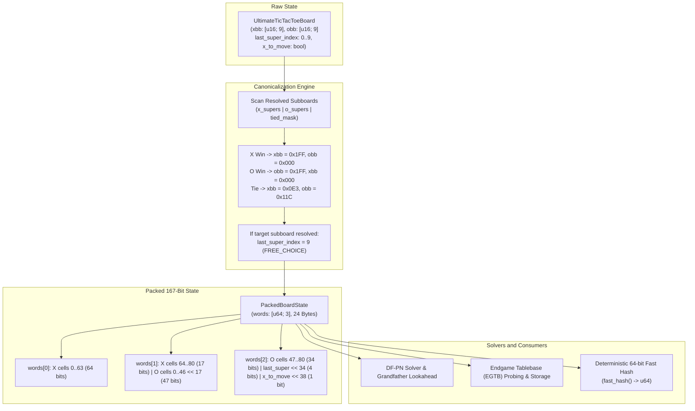

# Implementation Plan: Canonical Resolved Subboards, 167-Bit State Representation, and Search Optimization

## Goal Description
In Ultimate Tic-Tac-Toe (UTTT), game-theoretic solving via Depth-First Proof-Number search (`df-pn`) and Endgame Tablebase (`EGTB`) generation faces severe combinatorial explosion in the late midgame and endgame. A large fraction of this complexity is redundant because of two structural invariants of the game rules:

1. **Subboard Resolution Permanence**: Once a 3x3 subboard $k \in \{0, \dots, 8\}$ is won by X, won by O, or tied (CAT), **no legal move can ever be played inside that subboard again**.
2. **Directed Subboard Irrelevance upon Resolution**: If a player's move directs their opponent to subboard $k$, but subboard $k$ is already resolved, the opponent receives **free choice** across all remaining active subboards. The exact history of internal marks inside subboard $k$ has zero causal effect on subsequent moves or superboard evaluation.

Under raw representation, when 4 subboards are won, there are up to $131^4 \approx 2.94 \times 10^8$ distinct internal mark configurations describing the **exact same legal moves and superboard outcome**.

This plan accomplishes:
- **Canonical Resolved Subboards**: Every resolved subboard maps to a canonical configuration (e.g. X win $\to$ all 9 cells are X: `0x1FF`, O win $\to$ all 9 cells are O: `0x1FF`, CAT tie $\to$ canonical disjoint pattern: `0x0E3 / 0x11C`).
- **Directed Subboard Normalization**: Whenever a move directs to an already resolved subboard, normalize `last_super_index` to $9$ (`FREE_CHOICE`), merging all such branching permutations into a single state.
- **167-Bit Packed Integer State Representation (`PackedBoardState`)**: As observed, the next subboard index takes only 4 bits ($0 \dots 9$), the board takes at most $4 \times 81$ bits (and specifically $81 + 81 = 162$ bits for X and O bitboards), and the side to move takes 1 bit. Total: $81 + 81 + 4 + 1 = 167$ bits, fitting into a 24-byte integer structure (`[u64; 3]`). This provides **zero hash collisions**, cache-line efficiency, and deterministic fast hashing.
- **Grandfather Search & EGTB Integration**: 2-ply lookahead in DF-PN and 2-ply retrograde propagation in EGTB to exploit canonical states and eliminate search oscillations.

---

## User Review Required

> [!IMPORTANT]
> **Subboard Tie vs. Win Bitmask Guard in `get_tied_mask()`**
> In the existing codebase, `get_tied_mask()` identifies full subboards using `match xbb | obb { CAT => Some(1 << index), _ => None }`. When an X-won subboard is canonicalized to all 9 Xs (`xbb = 0x1FF, obb = 0x000`), `xbb | obb` equals `CAT` (`0x1FF = 511`).
> We will update `get_tied_mask()` to guard against won boards:
> `let won = self.x_supers | self.o_supers; if (won & (1 << index)) == 0 && (xbb | obb) == CAT { ... }`.
> This guarantees an all-X won subboard is never misclassified as a tie.

> [!NOTE]
> **Non-Destructive vs. In-Place Canonicalization**
> To ensure 100% backward compatibility with all existing bots, arena matches, and unit tests, canonicalization is provided as:
> 1. `PackedBoardState::from_board_canonical(&board)`: Produces the exact 167-bit canonical key for transposition tables, DF-PN, opening books, and EGTBs without mutating the live playing board.
> 2. `board.to_canonical() -> UltimateTicTacToeBoard`: Produces a new canonical board instance.
> 3. `board.canonicalize_resolved()`: In-place transformation when working with solver states.

---

## Open Questions

> [!TIP]
> **Transposition Table Key Format in DF-PN Solver**
> `DfPnSolver` currently uses `HashMap<u64, ProofNumbers>`. With `PackedBoardState` (24 bytes), we can either:
> - Option A (Recommended): Store `HashMap<PackedBoardState, ProofNumbers>` directly. Zero hash collisions guaranteed, exact equality in 3 CPU word comparisons.
> - Option B: Use `u64` computed from `PackedBoardState::fast_hash()` using 64-bit mixing (WyHash / SplitMix64). Slightly smaller hash map keys (8 bytes vs 24 bytes) with negligible collision risk.
> We will implement `PackedBoardState` with both `Eq` and `fast_hash()`, defaulting Option A for DF-PN and EGTB where exact correctness is paramount.

---

## Mathematical & Architectural Design



### 1. Bit Allocation Table (167 Bits in 24 Bytes)

| Field | Bit Count | Representation | Layout in `[u64; 3]` |
| :--- | :--- | :--- | :--- |
| **X Cells** | 81 bits | $9 \times 9$-bit subboards concatenated | `words[0]` (bits 0..63) + `words[1]` (bits 0..16) |
| **O Cells** | 81 bits | $9 \times 9$-bit subboards concatenated | `words[1]` (bits 17..63) + `words[2]` (bits 0..33) |
| **Target Subboard** | 4 bits | $0 \dots 9$ ($9 = \text{Free Choice}$) | `words[2]` (bits 34..37) |
| **Turn** | 1 bit | $1 = \text{X to move}, 0 = \text{O to move}$ | `words[2]` (bit 38) |
| **Padding** | 25 bits | Set to 0 | `words[2]` (bits 39..63) |
| **Total** | **167 bits** | **Fits in 192 bits (24 bytes)** | **Cache-aligned, copyable by value** |

---

## Proposed Changes

### Core State & Canonicalization Layer

#### [NEW] `uttt/src/packed_state.rs`
- Defines `PackedBoardState` struct with `words: [u64; 3]`.
- Implements `from_board(board: &UltimateTicTacToeBoard) -> Self`.
- Implements `from_board_canonical(board: &UltimateTicTacToeBoard) -> Self`.
- Implements `to_board(&self) -> UltimateTicTacToeBoard`.
- Implements `fast_hash(&self) -> u64` using 64-bit mixing.
- Implements `Display`, `PartialEq`, `Eq`, `Hash`, `Clone`, `Copy`, `Default`.

```rust
#[derive(Clone, Copy, PartialEq, Eq, PartialOrd, Ord, Hash, Debug, Default)]
pub struct PackedBoardState {
    pub words: [u64; 3], // 24 bytes
}

impl PackedBoardState {
    pub fn from_board(board: &UltimateTicTacToeBoard) -> Self {
        // Pack 81 bits of X, 81 bits of O, 4 bits of last_super_index, 1 bit of x_to_move
        ...
    }

    pub fn to_board(&self) -> UltimateTicTacToeBoard {
        ...
    }

    #[inline(always)]
    pub fn fast_hash(&self) -> u64 {
        let mut h = self.words[0].wrapping_mul(0x9E37_79B9_7F4A_7C15);
        h = (h ^ (h >> 30)).wrapping_mul(0xBF58_476D_1CE4_E5B9);
        h ^= self.words[1].wrapping_mul(0x94D0_49BB_1331_11EB);
        h = (h ^ (h >> 27)).wrapping_mul(0xBF58_476D_1CE4_E5B9);
        h ^= self.words[2].wrapping_mul(0x9E37_79B9_7F4A_7C15);
        h ^ (h >> 31)
    }
}
```

#### [NEW] `uttt/src/canonical.rs`
- Canonical constants:
  - `CANONICAL_X_WIN = 0x1FF` (all 9 squares set to X)
  - `CANONICAL_O_WIN = 0x1FF` (all 9 squares set to O)
  - `CANONICAL_TIE_X = 0x0E3` (`0b011100011`, 5 squares)
  - `CANONICAL_TIE_O = 0x11C` (`0b100011100`, 4 squares, strictly disjoint, no 3-in-a-row)
  - `FREE_CHOICE_INDEX = 9`
- `canonicalize_board(board: &mut UltimateTicTacToeBoard)`
- `to_canonical_board(board: &UltimateTicTacToeBoard) -> UltimateTicTacToeBoard`
- `normalize_directed_subboard(board: &mut UltimateTicTacToeBoard)`

#### [MODIFY] `uttt/src/uttt_trait_solving.rs`
- In `get_tied_mask()`: guard against won subboards:
```rust
pub fn get_tied_mask(&self) -> u16 {
    let won = self.x_supers | self.o_supers;
    self.xbb
        .iter()
        .zip(self.obb.iter())
        .enumerate()
        .filter_map(|(index, (xbb, obb))| {
            if (won & (1 << index)) == 0 && (xbb | obb) == CAT {
                Some(1u16 << index)
            } else {
                None
            }
        })
        .fold(0u16, |current, next| current | next)
}
```
- Provide `to_canonical(&self) -> UltimateTicTacToeBoard` and `to_packed_canonical(&self) -> PackedBoardState` convenience methods.

#### [MODIFY] `uttt/src/lib.rs`
- Expose modules:
```rust
pub mod canonical;
pub mod packed_state;
```

---

### Solvers & Tablebase Integration

#### [MODIFY] `uttt/src/dfpn/mod.rs`
- Update `DfPnSolver` to support `PackedBoardState` keys:
  - `pub tt: HashMap<PackedBoardState, ProofNumbers>`
  - Update `solve` and `mid` to use `PackedBoardState::from_board_canonical(board)`.
- Implement 2-ply Grandfather Lookahead in `mid()`:
  - Before expanding child node $C$ (AND-node), inspect immediate grandchild terminal proofs.
  - If any grandchild is a terminal win for the attacker, immediately disprove $C$ without deep recursion.
  - Implement ancestor-cycle check to prevent threshold oscillations.

#### [MODIFY] `uttt/src/egtb/mod.rs`
- Integrate canonical resolved states into tablebase probing and generation.
- Positions are canonicalized before checking `visited` and before inserting into tablebase.
- Results in significantly higher tablebase probe hit rates during endgame playouts.

---

### Verification & Testing Suite

#### [NEW] `uttt-tests/src/canonical_state_tests.rs`
Comprehensive verification tests covering:
1. **Move Legality Invariance**: For any board $B$, `B.get_legal_moves() == B.to_canonical().get_legal_moves()`.
2. **Win State Invariance**: `B.get_win_state() == B.to_canonical().get_win_state()`.
3. **Score Invariance**: `B.score() == B.to_canonical().score()`.
4. **Packed Representation Roundtrip**: `PackedBoardState::from_board(b).to_board() == b` across 10,000 random playout boards.
5. **Transposition Collapse Verification**:
   - Construct board 1: X wins subboard 0 via row 0 (`0x007`).
   - Construct board 2: X wins subboard 0 via diagonal (`0x111`).
   - All other boards identical.
   - Assert `board1.to_packed_canonical() == board2.to_packed_canonical()`.
6. **Directed Subboard Normalization**:
   - Verify that moves directing to completed subboards normalize to `last_super_index = 9`.
   - Verify that all such variations collapse into identical `PackedBoardState`.
7. **Grandfather Search Node Reduction Benchmark**:
   - Measure search node count with and without canonical state collapsing on late-game positions ($\ge 3$ resolved subboards).

#### [MODIFY] `uttt-tests/src/lib.rs`
- Register `mod canonical_state_tests;`.

---

## Verification Plan

### Automated Tests
Execute the full test suite with Rust compiler in PATH:
```bash
export PATH="$HOME/.cargo/bin:$PATH"
cargo test --package uttt --package uttt-tests
```
- Verify all 46 existing tests continue to pass with 0 regressions.
- Verify all new canonical state and packed integer tests pass with 0 failures.

### Correctness & Equivalence Benchmarks
Run a focused test verifying transposition collapse and roundtrip fidelity:
```bash
export PATH="$HOME/.cargo/bin:$PATH"
cargo test --package uttt-tests -- canonical_state_tests --nocapture
```

### Manual Verification
1. Inspect the terminal output for canonical board representations to confirm won subboards render clearly with solid blocks of marks.
2. Confirm the memory footprint of `PackedBoardState` is exactly 24 bytes via `assert_eq!(std::mem::size_of::<PackedBoardState>(), 24);`.
