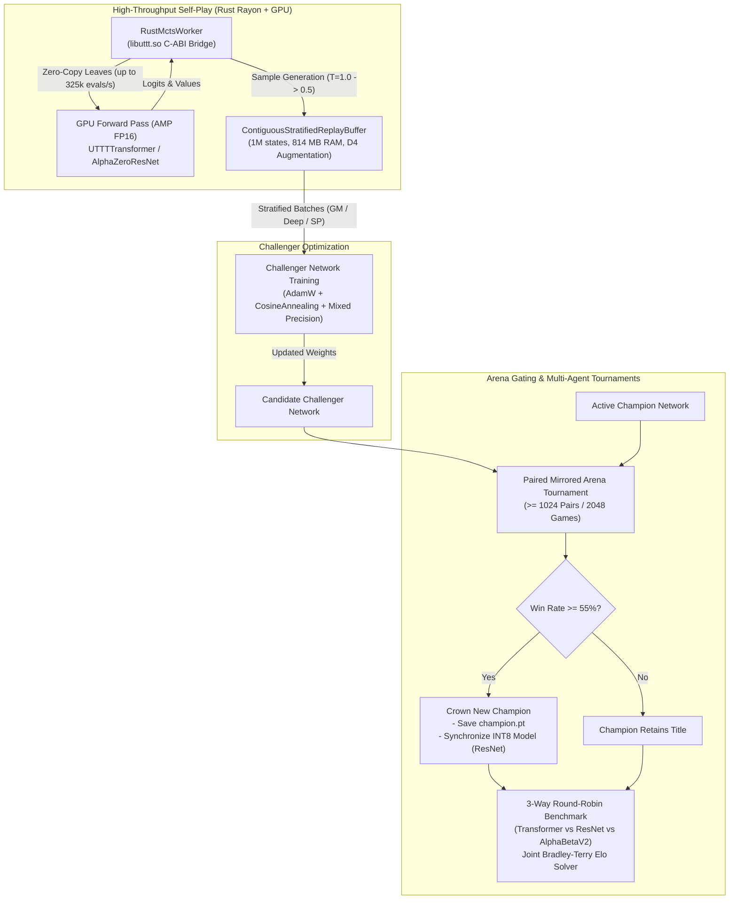

# AlphaZero ML Subsystem: Architecture & Plans

This document synthesizes the overarching architectural design, component responsibilities, and execution plans of the AlphaZero Machine Learning and self-play subsystem based on the module plans in this directory.

---

## 1. System Architecture Overview

The `ml/` subsystem implements an end-to-end autonomous reinforcement learning framework for Ultimate Tic-Tac-Toe. It bridges native compiled multi-threaded Rust search engines with PyTorch deep neural networks to produce grandmaster-level play without human domain heuristics.

---

## 2. Core Subsystems & Components

### 2.1 Native Rust Rayon MCTS Engine Bridge
- **Module**: [`rust_mcts_worker.py`](file:///home/festivity/agy/uttt-codingame/ml/rust_mcts_worker.py) ([`rust_mcts_worker_plans.md`](file:///home/festivity/agy/uttt-codingame/ml/rust_mcts_worker_plans.md))
- **Role**: Coordinates parallel search across 1,024 to 2,048 simultaneous games via `ctypes` foreign function bindings to `libuttt.so`.
- **Responsibilities**:
  - Executes Rayon multi-threaded selection, expansion, and backpropagation on CPU.
  - Slices leaf evaluation batches into pre-allocated contiguous shared memory buffers.
  - Supports dual-model evaluation routing for arena competitions.
  - Executes native multi-threaded AlphaBeta minimax searches over flattened game histories.

### 2.2 Contiguous Stratified Experience Storage
- **Module**: [`replay_buffer.py`](file:///home/festivity/agy/uttt-codingame/ml/replay_buffer.py) ([`replay_buffer_plans.md`](file:///home/festivity/agy/uttt-codingame/ml/replay_buffer_plans.md))
- **Role**: High-density experience storage maintaining up to 1,000,000 transitions in ~814 MB host RAM.
- **Responsibilities**:
  - Segregates data into three protected ring buffers: Grandmaster (30%), Deep Tactical / Draws (35%), and Self-Play (35%).
  - Packs spatial bitboards and masks into `uint8` format to eliminate Python object allocation overhead.
  - Precomputes 8 dihedral permutations (`D4_PERMUTATIONS`) to provide on-the-fly $8\times$ data augmentation during batch sampling.
  - Supports atomic disk persistence via `.npz` memory-mapped checkpoints.

### 2.3 Deep Neural Network Architectures
- **Modules**:
  - [`model.py`](file:///home/festivity/agy/uttt-codingame/ml/model.py) ([`model_plans.md`](file:///home/festivity/agy/uttt-codingame/ml/model_plans.md))
  - [`transformer_model.py`](file:///home/festivity/agy/uttt-codingame/ml/transformer_model.py) ([`transformer_model_plans.md`](file:///home/festivity/agy/uttt-codingame/ml/transformer_model_plans.md))
- **Responsibilities**:
  - **Residual CNN (`AlphaZeroResNet`)**: 5-channel $9 \times 9$ spatial input, 4 residual blocks (64 channels), dual policy and value heads. Direct mapping to pure Rust INT8 SIMD engine.
  - **Vision/Board Transformer (`UTTTTransformer`)**: 81 spatial cell tokens + 1 `[CLS]` token, 4 Pre-LN transformer encoder layers with 4 heads ($d_{\text{model}}=128$, $d_{\text{ff}}=512$), decomposed subboard/subsquare positional embeddings. Evaluates instantaneous non-local board routing constraints at $> 68,000$ evals/sec.
  - **State Encoding & Mapping**: Bijective 2D coordinate transformation functions (`move_index_to_row_col`, `row_col_to_move_index`) and 5-channel state construction (`encode_board`).

### 2.4 Autonomous Self-Improvement Lifecycle
- **Module**: [`champion_challenger.py`](file:///home/festivity/agy/uttt-codingame/ml/champion_challenger.py) ([`champion_challenger_plans.md`](file:///home/festivity/agy/uttt-codingame/ml/champion_challenger_plans.md))
- **Role**: Coordinates the continuous self-play, optimization, gating, and checkpointing lifecycle.
- **Responsibilities**:
  - Dynamically detects and instantiates Champion architectures (`UTTTTransformer` vs `AlphaZeroResNet`).
  - Implements scheduled self-play temperatures ($T=1.0$ for plies $\le 20$, $T=0.5$ for plies $> 20$).
  - Optimizes Challenger parameters with AdamW, mixed-precision autocasting (AMP), and Cosine Annealing learning rate schedules.
  - Conducts paired mirror arena tournaments ($\ge 1,024$ pairs / $2,048$ games) enforcing a strict $\ge 55\%$ promotion threshold.
  - Produces atomic live JSON telemetry for real-time monitoring and synchronizes INT8 engine weights upon promotion.

### 2.5 Multi-Agent Tournaments & Rating Calibration
- **Module**: [`tournament_3way.py`](file:///home/festivity/agy/uttt-codingame/ml/tournament_3way.py) ([`tournament_3way_plans.md`](file:///home/festivity/agy/uttt-codingame/ml/tournament_3way_plans.md))
- **Role**: Benchmarks heterogeneous competitors (Transformer vs. ResNet vs. native AlphaBeta minimax).
- **Responsibilities**:
  - Mines contested paired positions to eliminate opening bias.
  - Executes phase-aligned synchronous batching (interleaving GPU MCTS and multi-core AlphaBeta minimax).
  - Solves joint maximum-likelihood Bradley-Terry rating models anchored at `AlphaZeroResNet = 1906.4 Elo`.
  - Decomposes outcomes into double wins (2-0, 0-2) and symmetrical splits (1-1).

---

## 3. Cross-Module Integration Map

| Component / File | Primary Interfaces & APIs | Downstream Consumers |
|---|---|---|
| [`model.py`](file:///home/festivity/agy/uttt-codingame/ml/model.py) | [`AlphaZeroResNet`](file:///home/festivity/agy/uttt-codingame/ml/model.py#L35-L83), [`encode_board`](file:///home/festivity/agy/uttt-codingame/ml/model.py#L102-L183), coordinate helpers | `champion_challenger.py`, `rust_mcts_worker.py`, `tournament_3way.py`, `replay_buffer.py` |
| [`transformer_model.py`](file:///home/festivity/agy/uttt-codingame/ml/transformer_model.py) | [`UTTTTransformer`](file:///home/festivity/agy/uttt-codingame/ml/transformer_model.py#L22-L139) | `champion_challenger.py`, `tournament_3way.py` |
| [`replay_buffer.py`](file:///home/festivity/agy/uttt-codingame/ml/replay_buffer.py) | [`ContiguousStratifiedReplayBuffer`](file:///home/festivity/agy/uttt-codingame/ml/replay_buffer.py#L48-L365), [`ReplayBufferDataset`](file:///home/festivity/agy/uttt-codingame/ml/replay_buffer.py#L371-L389) | `champion_challenger.py` |
| [`rust_mcts_worker.py`](file:///home/festivity/agy/uttt-codingame/ml/rust_mcts_worker.py) | [`RustMctsWorker`](file:///home/festivity/agy/uttt-codingame/ml/rust_mcts_worker.py#L17-L395) | `champion_challenger.py`, `tournament_3way.py` |
| [`champion_challenger.py`](file:///home/festivity/agy/uttt-codingame/ml/champion_challenger.py) | [`run_champion_challenger`](file:///home/festivity/agy/uttt-codingame/ml/champion_challenger.py#L214-L575), [`write_status`](file:///home/festivity/agy/uttt-codingame/ml/champion_challenger.py#L61-L80) | CLI entrypoint, web monitoring |
| [`tournament_3way.py`](file:///home/festivity/agy/uttt-codingame/ml/tournament_3way.py) | [`solve_bradley_terry`](file:///home/festivity/agy/uttt-codingame/ml/tournament_3way.py#L58-L111), [`run_neural_vs_neural_match`](file:///home/festivity/agy/uttt-codingame/ml/tournament_3way.py#L114-L227), [`run_neural_vs_alphabeta_match`](file:///home/festivity/agy/uttt-codingame/ml/tournament_3way.py#L229-L364) | CLI benchmark entrypoint |

---

## 4. Verification and Validation Strategy

1. **Paired Mirrored Evaluations**: Gating matches instantiate both $P_k$ (Game $2k$) and its color-inverted mirror (Game $2k+1$) to strictly eliminate opening and first-move advantage.
2. **Promotion Guardrails**: Self-play cycles enforce $\ge 2,048$ gating games and a $\ge 55\%$ win rate with confidence intervals before promoting checkpoints.
3. **Isolated Test Mode**: CLI `--test-mode` flags route all checkpoints, metadata, and buffers to hidden `.test_*` files to safeguard production training weights.
4. **Anchor-Calibrated Ratings**: All model benchmarks converge through Minorization-Maximization Bradley-Terry solvers anchored to fixed reference Elo baselines.
