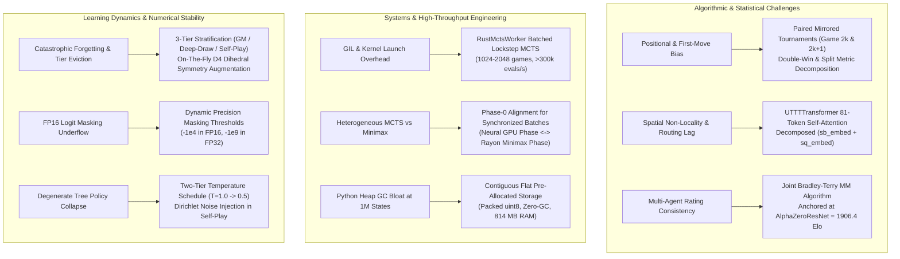

# AlphaZero ML Subsystem: Technical Challenges & Problem Domain

This document synthesizes the foundational algorithmic, mathematical, systems-level, and numerical challenges solved across the `ml/` subsystem based on the module problem documents in this directory.

---

## 1. Problem Domain Overview

Reinforcement learning for Ultimate Tic-Tac-Toe presents unique technical hurdles distinct from standard board games like Chess or Go:
- **Hierarchical Non-Local Dynamics**: Move placement within an individual subboard forces the opponent to play in a physically distant subboard on the next ply.
- **Hardware Bottlenecks**: High-depth MCTS requires hundreds of thousands of board evaluations per second; naive Python implementations suffer from GIL contention, kernel launch overhead, and memory allocation stalls.
- **Evaluation Asymmetries**: Sharp first-move initiative and tactical opening advantages can corrupt model rating and promotion decisions unless strictly isolated.
- **Numerical Edge Cases**: Automatic mixed-precision training easily triggers FP16 underflow and gradient NaN corruption when dealing with illegal move masking.

---

## 2. In-Depth Technical Challenges & Engineered Solutions



---

### 2.1 Spatial Non-Locality and Receptive Field Lag
- **Problem**: In standard $3 \times 3$ convolutional networks ([`model_problems.md`](file:///home/festivity/agy/uttt-codingame/ml/model_problems.md)), information propagates by only one cell per convolutional layer. In Ultimate Tic-Tac-Toe, playing in subboard $B$ at cell $(r_{\text{sub}}, c_{\text{sub}})$ immediately directs the opponent to subboard $B' = 3 \cdot r_{\text{sub}} + c_{\text{sub}}$. Detecting this forced destination requires 3 to 4 convolutional layers, introducing receptive field lag.
- **Solution**: [`transformer_model_problems.md`](file:///home/festivity/agy/uttt-codingame/ml/transformer_model_problems.md) introduces [`UTTTTransformer`](file:///home/festivity/agy/uttt-codingame/ml/transformer_model.py#L22-L139), modeling the board as 81 contextualized cell tokens. Full self-attention computes direct pairwise routing between cell $(r_{\text{sub}}, c_{\text{sub}})$ and destination subboard $B'$ in Layer 1. Additive subboard and subsquare embeddings (`sb_embed` + `sq_embed`) decouple the macro position from the routing directive.

### 2.2 First-Move and Positional Bias Elimination
- **Problem**: [`champion_challenger_problems.md`](file:///home/festivity/agy/uttt-codingame/ml/champion_challenger_problems.md) and [`tournament_3way_problems.md`](file:///home/festivity/agy/uttt-codingame/ml/tournament_3way_problems.md) highlight that Player 1 (X) possesses a natural initiative. Evaluating unanchored games allows a weaker challenger to win promotions merely by luck in color assignment or opening draws.
- **Solution**: Paired mirrored opening suites:
  - Every mined contested position $P_k$ is instantiated as a complementary pair: Game $2k$ (Agent A plays first from $P_k$) and Game $2k+1$ (Agent B plays first from $P_k$).
  - Results are decomposed into double wins (2-0, 0-2) and symmetrical splits (1-1).
  - Production gating requires $\ge 1,024$ pairs ($2,048$ games) and a $\ge 55\%$ win rate, providing rigorous statistical proof of superiority before promotion.

### 2.3 CPU-GPU Pipeline Saturation & Heterogeneous Engine Synchronization
- **Problem**: Small, sequential GPU forward passes spend most of their execution time in PyTorch launch overhead, leaving tensor cores idle ($< 5\%$ utilization). Furthermore, competing neural networks against native AlphaBeta minimax engines creates synchronization stalls, as MCTS evaluates trees in batches while AlphaBeta searches sequential moves.
- **Solution**:
  - [`rust_mcts_worker_problems.md`](file:///home/festivity/agy/uttt-codingame/ml/rust_mcts_worker_problems.md): Batches tree operations across 1,024 to 2,048 games in lockstep. Rust Rayon threads perform parallel descent and backpropagation in $< 0.2$ ms, passing leaf batches via shared host pointers for a single batched GPU forward pass, achieving $> 300,000$ evals/sec.
  - [`tournament_3way_problems.md`](file:///home/festivity/agy/uttt-codingame/ml/tournament_3way_problems.md): Implements "Phase-0 Alignment." In odd games, AlphaBeta takes the initial move at ply 0. This immediately synchronizes all 512 games to the Neural model's turn, allowing execution to alternate between 100% GPU MCTS batches and 100% multi-core Rayon minimax batches.

### 2.4 Zero-GC Experience Storage & Stratified Retention
- **Problem**: Storing $1,000,000$ transitions using native Python objects incurs $> 4$ GB RAM overhead and triggers severe GC pauses. Standard FIFO eviction rapidly discards rare tactical endgames, leading to catastrophic forgetting.
- **Solution**: [`replay_buffer_problems.md`](file:///home/festivity/agy/uttt-codingame/ml/replay_buffer_problems.md) pre-allocates contiguous flat NumPy storage (`uint8` for bitboard channels and masks), bounding RAM usage to $814$ MB with zero Python object allocations. Dedicated ring-buffer tiers protect Grandmaster (30%) and Deep Tactical / Draw (35%) experiences from being overwritten by high-volume short self-play games (35%). Precomputed lookup tables apply on-the-fly D4 dihedral symmetry transformations to policies and observations during batch sampling.

### 2.5 FP16 Mixed-Precision Underflow in Masked Attention & Logits
- **Problem**: Illegal moves must be suppressed before softmax. Standard FP32 masking uses $-1 \times 10^9$. Under PyTorch AMP (`float16`), the minimum normal float is $\approx -65504$. Masking with $-1 \times 10^9$ causes overflow to `-inf`, leading to `NaN` values during log-softmax backpropagation and catastrophic weight corruption.
- **Solution**: [`model_problems.md`](file:///home/festivity/agy/uttt-codingame/ml/model_problems.md) and [`transformer_model_problems.md`](file:///home/festivity/agy/uttt-codingame/ml/transformer_model_problems.md) dynamically detect tensor precision at runtime:
  ```python
  fill_val = -1e4 if logits.dtype == torch.float16 else -1e9
  logits = torch.where(legal_mask.bool(), logits, torch.full_like(logits, fill_val))
  ```
  The value $-1 \times 10^4$ evaluates to $\exp(-10000) = 0.0$ in softmax without exceeding FP16 dynamic range.

---

## 3. Invariants and Safety Guarantees

| Invariant / Guardrail | Implementation | Purpose / Protected Failure Mode |
|---|---|---|
| **Atomic Telemetry & Checkpoints** | `temp_file = path + '.tmp'`; `os.replace` | Prevents corrupt reads by web dashboards and protects checkpoints from crashes during disk writes. |
| **Production State Protection** | `--test-mode` redirects paths to `.test_*` | Safeguards production model weights (`champion.pt`) and replay buffers from testing experiments. |
| **Bounded Value Predictions** | `nn.Tanh()` in value heads | Guarantees neural value outputs strictly reside in $[-1.0, 1.0]$. |
| **Dynamic Batch Termination** | Sentinel move `255` and status checks | Prevents out-of-bounds indexing or redundant computation on finished games during tournament play. |
| **Dynamic Tier Proportions** | Allocation scales with populated counts | Avoids zero-division errors and oversampling when starting training on partially filled replay buffers. |
| **Deterministic Benchmarking** | $T = 0.0$ and $\epsilon_{\text{dir}} = 0.0$ | Ensures tournament evaluations reflect true competitive capability without stochastic noise. |
