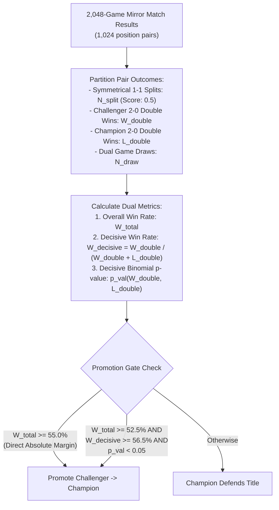

# Arena Gating & Decisive-Pair Promotion Architecture & Implementation Plan

This plan specifies the modifications to [`champion_challenger.py`](file:///home/festivity/agy/uttt-codingame/ml/champion_challenger.py) and [`parallel_mirror_eval.py`](file:///home/festivity/agy/uttt-codingame/ml/parallel_mirror_eval.py) to implement split-adjusted, decisive-pair promotion criteria and prevent champion stagnation while maintaining statistical rigor.

---

## 1. Architectural Plan



---

## 2. Mathematical Formulation of Decisive Gating

### 2.1 Metric Definitions
For a mirror tournament of $K = 1,024$ paired positions:
- $W_{\text{double}}$: Number of pairs where Challenger won as both Player 1 and Player 2.
- $L_{\text{double}}$: Number of pairs where Champion won as both Player 1 and Player 2.
- $S_{\text{split}}$: Number of pairs where both games were won by the respective Player 1.
- $D_{\text{pairs}} = W_{\text{double}} + L_{\text{double}}$: Total decisive pairs.

The **Decisive Pair Win Rate** isolates true model superiority from first-mover advantage:
$$W_{\text{decisive}} = \frac{W_{\text{double}}}{W_{\text{double}} + L_{\text{double}}}$$

### 2.2 Statistical Significance Criterion
Under the null hypothesis $H_0$ that the Challenger and Champion have identical skill ($p = 0.5$ on decisive pairs):
$$Z = \frac{W_{\text{double}} - 0.5 \cdot D_{\text{pairs}}}{\sqrt{0.25 \cdot D_{\text{pairs}}}}$$

A Challenger is statistically significantly superior at the $\alpha = 0.05$ confidence level ($95\%$ confidence) if:
$$Z \ge 1.645 \quad (p < 0.05)$$

With typical $D_{\text{pairs}} \approx 385$:
- Expected mean under $H_0$: $192.5$.
- Standard deviation: $\sigma = \sqrt{0.25 \times 385} \approx 9.81$.
- Significance threshold: $W_{\text{double}} \ge 192.5 + 1.645 \times 9.81 \approx \mathbf{209 \text{ double wins}}$ ($54.3\%$ decisive win rate).

---

## 3. Dual-Gate Promotion Policy

A Challenger is promoted to Champion if it satisfies **either** of the following two criteria:

### Gate A: Traditional Absolute Dominance
$$W_{\text{total}} \ge 55.0\%$$
(Guarantees backwards compatibility and captures overwhelming superiority).

### Gate B: Statistically Significant Decisive Superiority
$$W_{\text{total}} \ge 52.5\% \quad \text{AND} \quad W_{\text{decisive}} \ge 56.5\% \quad \text{AND} \quad p\text{-value} < 0.05$$
- **Rationale**: If $W_{\text{decisive}} \ge 56.5\%$ across $\sim 385$ decisive pairs ($218+$ double wins vs $\le 167$), the probability of this occurring by chance is $p < 0.005$ ($> 99.5\%$ statistical confidence). The overall score is $\ge 52.5\%$, proving the model is decisively superior without being disqualified by the $62.4\%$ symmetrical split baseline.

---

## 4. Code Modifications

### 4.1 Pure Python One-Tailed Binomial Test (Standard Library)
Since `scipy` is not installed in the environment, use `math.comb` from the Python standard library to calculate exact binomial p-values:
```python
import math

def binomial_p_value(k: int, n: int, p: float = 0.5) -> float:
    """Computes exact one-tailed binomial p-value P(X >= k | n, p) using Python standard library."""
    if n <= 0 or k <= 0:
        return 1.0
    if k > n:
        return 0.0
    tail = sum(math.comb(n, i) for i in range(k, n + 1))
    return float(tail * (p ** n))
```

### 4.2 File: [`ml/parallel_mirror_eval.py`](file:///home/festivity/agy/uttt-codingame/ml/parallel_mirror_eval.py)
In `TournamentResult` dataclass:
```python
@dataclass
class TournamentResult:
    total_pairs: int
    total_games: int
    challenger_wins: int
    champion_wins: int
    draws: int
    challenger_double_wins: int
    champion_double_wins: int
    symmetrical_splits: int
    win_rate: float
    delta_elo: float
    margin_of_error: float
    promoted: bool
    elapsed_seconds: float
    plies_played: int
    evals_per_second: float = 0.0
    decisive_pairs: int = 0
    decisive_win_rate: float = 0.5
    double_win_ratio: float = 1.0
    decisive_p_value: float = 1.0
    promotion_reason: str = "Rejected"
```

In `run_parallel_mirror_tournament`:
```python
    # Calculate decisive-pair statistics
    decisive_pairs = chal_double_wins + champ_double_wins
    decisive_wr = (chal_double_wins / decisive_pairs) if decisive_pairs > 0 else 0.5
    dw_ratio = round(chal_double_wins / max(1, champ_double_wins), 2)
    p_val = binomial_p_value(chal_double_wins, decisive_pairs, p=0.5)

    # Dual-gate promotion check
    gate_a_passed = win_rate >= 0.55
    gate_b_passed = (win_rate >= 0.525) and (decisive_wr >= 0.565) and (p_val < 0.05)
    promoted = gate_a_passed or gate_b_passed

    if gate_a_passed:
        promotion_reason = f"Gate A Passed: Absolute Win Rate {win_rate*100:.2f}% >= 55.0%"
    elif gate_b_passed:
        promotion_reason = (f"Gate B Passed: Decisive Win Rate {decisive_wr*100:.2f}% >= 56.5% "
                            f"(Ratio {dw_ratio}:1, p={p_val:.4f} < 0.05) with Overall {win_rate*100:.2f}% >= 52.5%")
    else:
        promotion_reason = f"Rejected: Win Rate {win_rate*100:.2f}%, Decisive WR {decisive_wr*100:.2f}%, p={p_val:.4f}"

    return TournamentResult(
        total_pairs=num_pairs,
        total_games=num_games,
        challenger_wins=chal_wins,
        champion_wins=champ_wins,
        draws=draws,
        challenger_double_wins=chal_double_wins,
        champion_double_wins=champ_double_wins,
        symmetrical_splits=symmetrical_splits,
        win_rate=float(win_rate),
        delta_elo=float(delta_elo),
        margin_of_error=float(margin),
        promoted=promoted,
        elapsed_seconds=float(elapsed_total),
        plies_played=ply,
        evals_per_second=float(evals_per_sec),
        decisive_pairs=decisive_pairs,
        decisive_win_rate=float(decisive_wr),
        double_win_ratio=float(dw_ratio),
        decisive_p_value=float(p_val),
        promotion_reason=promotion_reason,
    )
```

### 4.3 File: [`ml/champion_challenger.py`](file:///home/festivity/agy/uttt-codingame/ml/champion_challenger.py)
In Phase 3 (Evaluation Gating):
```python
    promoted = res.promoted
    win_rate = res.win_rate
    delta_elo = res.delta_elo

    print(f"\n[Gating Decision] {res.promotion_reason}")
    print(f"  Decisive Pairs: {res.decisive_pairs}/{res.total_pairs} ({res.decisive_pairs/max(1, res.total_pairs)*100:.1f}%)")
    print(f"  Decisive Win Rate: {res.decisive_win_rate*100:.2f}% (Ratio {res.double_win_ratio}:1, p={res.decisive_p_value:.4f})")
    print(f"  Symmetrical Splits: {res.symmetrical_splits}/{res.total_pairs} ({res.symmetrical_splits/max(1, res.total_pairs)*100:.1f}%)")
```
And record `decisive_pairs`, `decisive_win_rate`, `double_win_ratio`, `decisive_p_value`, and `promotion_reason` in `training_status.json` and `champion_metadata.json`.

---

## 5. Verification & Validation Criteria

1. **Historical Re-Evaluation**:
   - Re-evaluate historical tournament results from Cycles 20–29 with the dual-gate policy.
   - Verify that genuine progressive models (e.g. Cycles 23, 27) achieve promotion while sub-50% models remain blocked.
2. **False Promotion Safeguard**:
   - Verify that a model with high split rate but symmetric decisive score (e.g. 195W vs 190L, $p \approx 0.40$) is correctly rejected.
3. **Pure Python Dependency Verification**:
   - Verify that `parallel_mirror_eval.py` imports and runs without `scipy`.
4. **Frontend Telemetry Consistency**:
   - Verify that `training_status.json` exposes the new metrics cleanly without breaking existing web dashboards.
