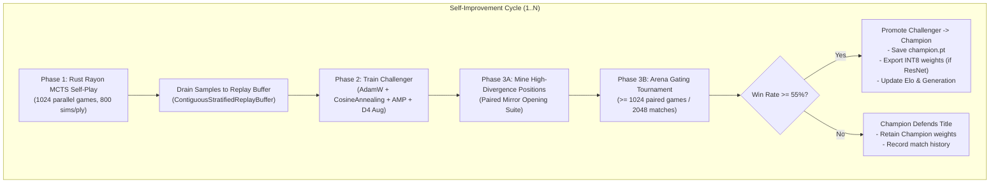

# Champion Challenger Architecture & Implementation Plan

The [`champion_challenger.py`](file:///home/festivity/agy/uttt-codingame/ml/champion_challenger.py) module implements the automated AlphaZero continuous self-improvement lifecycle for Ultimate Tic-Tac-Toe. It coordinates high-throughput parallel self-play, deep neural network optimization, statistical arena gating evaluation, and export synchronization.

---

## 1. Architectural Plan



The system cycles continuously through three primary phases:
1. **Self-Play Generation**: Executes parallel games via [`RustMctsWorker`](file:///home/festivity/agy/uttt-codingame/ml/rust_mcts_worker.py#L17-L395) evaluated against the current Champion network using temperature-scheduled stochastic move selection.
2. **Challenger Optimization**: Trains a deep copy of the Champion on stratified historical and self-play data with mixed precision (AMP) and D4 dihedral augmentation.
3. **Arena Gating & Verification**: Conducts a paired mirrored tournament between Challenger and Champion. If the Challenger achieves $\ge 55\%$ win rate with statistical significance, it is promoted to Champion and its weights are synchronized.

---

## 2. Module Structure & Dependencies

- **Hardware Inspection & Telemetry**:
  - Direct CUDA runtime interrogation (`torch.cuda.memory_allocated`, `torch.cuda.memory_reserved`, `get_device_properties`).
  - Atomic JSON disk persistence (`os.replace`) targeting both local and frontend paths.
- **Model Ingestion**:
  - Dynamically supports both [`AlphaZeroResNet`](file:///home/festivity/agy/uttt-codingame/ml/model.py#L35-L83) (convolutional residual architecture) and [`UTTTTransformer`](file:///home/festivity/agy/uttt-codingame/ml/transformer_model.py#L22-L139) (vision/board transformer) via state dictionary key inspection.
- **Data Subsystems**:
  - Ingests into [`ContiguousStratifiedReplayBuffer`](file:///home/festivity/agy/uttt-codingame/ml/replay_buffer.py#L48-L365) to maintain grandmaster, deep tactical draw, and self-play partitions.
- **Evaluation Subsystems**:
  - Direct batched GPU MCTS fallback via [`run_batched_gpu_mcts`](file:///home/festivity/agy/uttt-codingame/ml/batched_mcts.py).
  - Production gating tournaments via [`run_parallel_mirror_tournament`](file:///home/festivity/agy/uttt-codingame/ml/parallel_mirror_eval.py) and [`mine_interesting_positions`](file:///home/festivity/agy/uttt-codingame/ml/parallel_mirror_eval.py).
  - INT8 engine export via [`export_model_int8`](file:///home/festivity/agy/uttt-codingame/ml/export_int8.py).

---

## 3. Data Types & State Schemas

### GPU Telemetry Dictionary
```python
{
    "device": str,             # Hardware device name (e.g. "NVIDIA GeForce RTX 5060 Ti")
    "vram_allocated_gb": float,# Actively allocated PyTorch VRAM in GB
    "vram_reserved_gb": float, # Cached / reserved PyTorch VRAM in GB
    "vram_total_gb": float,    # Total device physical VRAM in GB
    "utilization_pct": float   # Reserved VRAM utilization percentage
}
```

### Metadata State Schema (`champion_metadata.json`)
```python
{
    "generation": int,          # Current champion generation index (0, 1, 2...)
    "champion_elo": float,      # Champion Elo rating (anchored at 1500.0 baseline)
    "champion_rd": float,       # Glicko/Bayesian rating deviation
    "total_games_played": int,  # Cumulative self-play games generated
    "total_promotions": int,    # Total successful challenger promotions
    "history": List[Dict]       # Historical record of all evaluation tournaments
}
```

---

## 4. Public API & Core Functions

### [`get_gpu_telemetry(device: str) -> Dict[str, any]`](file:///home/festivity/agy/uttt-codingame/ml/champion_challenger.py#L37-L58)
Queries PyTorch CUDA device properties and current memory usage. Returns CPU fallback values if CUDA is unavailable or CPU is specified.

### [`write_status(status_file: str, frontend_status_file: Optional[str], data: Dict[str, any])`](file:///home/festivity/agy/uttt-codingame/ml/champion_challenger.py#L61-L80)
Writes live telemetry atomically to disk:
1. Dumps data to a temporary file (`<status_file>.tmp`).
2. Atomically replaces target `<status_file>` using `os.replace`.
3. Optionally mirrors the file to `frontend_status_file` if the target directory exists.

### [`build_2ply_opening_suite(num_pairs: int) -> List[UTTTEnv]`](file:///home/festivity/agy/uttt-codingame/ml/champion_challenger.py#L82-L113)
Constructs an opening suite of balanced 2-ply positions:
- Iterates over all 9 subboards and 9 subsquares to build candidate 2-ply moves: $(m_1, \text{reply\_c})$.
- Shuffles with a fixed seed (`random.Random(42)`) and slices `num_pairs`.
- Initializes [`UTTTEnv`](file:///home/festivity/agy/uttt-codingame/ml/dataset.py) instances applying the 2 plies.

### [`play_eval_match(model_challenger, model_champion, num_games=40, mcts_sims=200, device="cuda") -> Tuple[int, int, int]`](file:///home/festivity/agy/uttt-codingame/ml/champion_challenger.py#L116-L211)
Legacy Python batched MCTS head-to-head match:
- Plays paired games on the 2-ply opening suite (Game $2k$ Challenger as P1; Game $2k+1$ Champion as P1).
- Dispatches batched MCTS steps via [`run_batched_gpu_mcts`](file:///home/festivity/agy/uttt-codingame/ml/batched_mcts.py) with `dirichlet_eps=0.0`.
- Returns `(challenger_wins, champion_wins, draws)`.

### [`run_champion_challenger(...)`](file:///home/festivity/agy/uttt-codingame/ml/champion_challenger.py#L214-L575)
The primary execution orchestrator controlling:
- Model initialization / architecture detection (`UTTTTransformer` vs `AlphaZeroResNet`).
- Buffer loading and sizing.
- Iterative cycle execution across Self-Play, Training, and Evaluation.
- Checkpoint persistence and INT8 quantization synchronization.

---

## 5. Verification & Testing Strategy

- **CLI Test Mode (`--test-mode`)**:
  - Diverts model checkpoints to `.test_champion.pt` and `.test_challenger.pt`.
  - Diverts buffer to `.test_buffer.npz` and metadata to `.test_champion_metadata.json`.
  - Disables frontend file writes and leaves production weights untouched.
- **Production Guardrails**:
  - When `not test_mode`, enforces `eval_pairs >= 1024` ($2,048$ games) and `promote_threshold >= 0.55` regardless of CLI inputs to ensure statistical significance.
- **Loss and Policy Monitoring**:
  - Employs mixed-precision gradient scaling (`torch.amp.GradScaler`), gradient clipping (`max_norm=1.0`), and Cosine Annealing learning rate scheduling.
