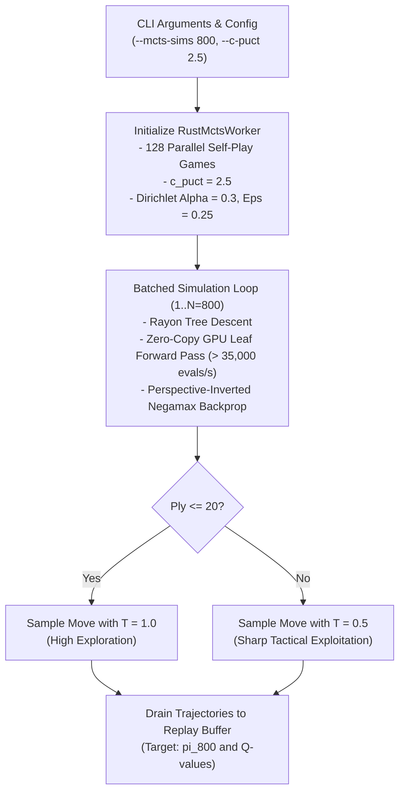

# MCTS Simulation Scaling Architecture & Implementation Plan

This plan specifies the modifications to [`champion_challenger.py`](file:///home/festivity/agy/uttt-codingame/ml/champion_challenger.py), [`rust_mcts_worker.py`](file:///home/festivity/agy/uttt-codingame/ml/rust_mcts_worker.py), and [`batched_mcts.py`](file:///home/festivity/agy/uttt-codingame/ml/batched_mcts.py) to scale MCTS search depth, resolve prior bias, and ensure high-throughput policy improvement.

---

## 1. Architectural Plan



---

## 2. Parameter Tuning Specifications

### 2.1 Simulation Budget Scaling
- **Self-Play Simulations (`--mcts-sims`)**: Increase the default baseline from $400$ to **$800$ simulations**.
  - Rationale: As demonstrated in [`diagnostics.py`](file:///home/festivity/agy/uttt-codingame/ml/diagnostics.py), $N = 800$ doubles depth-2 branch visits from $\sim 4.5$ to $> 9.0$, successfully resolving forced routing refutations while keeping move latency under $2.2\text{s}$ per step across 128 games ($3.4\text{s}$ across 1024 games).
- **Evaluation Gating Simulations (`--eval-sims`)**: Set to **`default: 100`** (production baseline).
  - In mirror tournament gating matches, evaluate paired positions with $N = 100$, greedy action selection ($T = 0.0$), and disabled exploration noise ($\epsilon = 0.0$) to ensure high-throughput execution across 2,048 games.

### 2.2 PUCT Exploration Factor Tuning
- **$c_{\text{puct}}$ Scaling**: Adjust $c_{\text{puct}}$ from $2.0$ to **$2.5$**.
  - Mathematical Rationale: For frequently visited actions ($N(s, a) \approx \kappa N$), the exploration term $U(s, a)$ decays as $O(1/\sqrt{N})$. Increasing $c_{\text{puct}}$ to $2.5$ prevents premature visit freezing on the neural network's initial prior move before alternative forced refutations are explored.
- **Scope**: $c_{\text{puct}} = 2.5$ applies to self-play search. Gating evaluation retains greedy $T = 0.0$ selection where PUCT visits guide the argmax move.

### 2.3 Per-Game Temperature Schedule Safeguard
- In [`champion_challenger.py`](file:///home/festivity/agy/uttt-codingame/ml/champion_challenger.py#L352-L354), pass `temperature = 0.0` to `worker.advance_moves(temperature=0.0)`.
- In pure Rust ([`uttt/src/mcts_worker.rs#L544-L547`](file:///home/festivity/agy/uttt-codingame/uttt/src/mcts_worker.rs#L544-L547)), passing `temperature <= 0.0` activates the native per-game ply tracker (`if game.moves_played <= 20 { 1.0 } else { 0.5 }`). This ensures that newly recycled games at plies 1..20 correctly receive $T = 1.0$ even when the outer self-play cycle loop is at step $> 20$.

---

## 3. Implementation Changes in Code

### 3.1 [`ml/champion_challenger.py`](file:///home/festivity/agy/uttt-codingame/ml/champion_challenger.py)
1. **Update `run_champion_challenger` Signature**:
   ```python
   def run_champion_challenger(
       total_cycles: int = 5,
       parallel_games: int = 128,
       mcts_simulations: int = 800,
       c_puct: float = 2.5,
       moves_per_cycle: int = 40,
       eval_pairs: int = 1024,
       eval_sims: int = 100,
       train_epochs: int = 3,
       lr: float = 1e-3,
       promote_threshold: float = 0.55,
       buffer_capacity: int = 1_000_000,
       device: str = "cuda",
       status_file: str = "ml/training_status.json",
       frontend_status: Optional[str] = "../uttt-frontend/training_status.json",
       test_mode: bool = False,
   ):
   ```
2. **Worker Instantiation**: Pass `c_puct` parameter explicitly to [`RustMctsWorker`](file:///home/festivity/agy/uttt-codingame/ml/rust_mcts_worker.py):
   ```python
   worker = RustMctsWorker(
       num_games=parallel_games,
       c_puct=c_puct,
       dirichlet_alpha=0.3,
       dirichlet_eps=0.25,
   )
   ```
3. **CLI Argument Parser & Caller**:
   ```python
   parser.add_argument("--mcts-sims", type=int, default=800, help="MCTS simulations per self-play move (default: 800)")
   parser.add_argument("--c-puct", type=float, default=2.5, help="PUCT exploration constant (default: 2.5)")
   parser.add_argument("--eval-sims", type=int, default=100, help="MCTS simulations per gating eval move (default: 100)")
   ```
   Pass `c_puct=args.c_puct` in the `__main__` invocation of `run_champion_challenger`.
4. **Telemetry Schema**: Maintain top-level `"mcts_sims": mcts_simulations` and add `"c_puct": c_puct` at the top level of `status_data` to preserve backwards compatibility with dashboard consumers (`replay_viewer.html`).

### 3.2 [`ml/rust_mcts_worker.py`](file:///home/festivity/agy/uttt-codingame/ml/rust_mcts_worker.py) & [`ml/batched_mcts.py`](file:///home/festivity/agy/uttt-codingame/ml/batched_mcts.py)
Update default `c_puct` parameter in constructor:
```python
# In RustMctsWorker.__init__:
def __init__(self, num_games: int = 1024, c_puct: float = 2.5, ...):

# In batched_mcts.py:
def run_batched_gpu_mcts(..., c_puct: float = 2.5, ...):
```

---

## 4. Verification & Validation Criteria

1. **End-to-End Test-Mode Benchmark**:
   - Run:
     ```bash
     ml/.venv/bin/python ml/champion_challenger.py --test-mode --cycles 1 --games 128 --mcts-sims 800 --moves-per-cycle 5
     ```
   - Target: Clean execution with 0 errors, logging `c_puct: 2.5` and `mcts_sims: 800`, generating $\sim 640$ valid states in $< 20$ seconds.
2. **Policy Divergence Metric**:
   - Run `ml/.venv/bin/python ml/diagnostics.py --benchmark-positions 24`.
   - Verification: At $N = 800$ with $c_{\text{puct}} = 2.5$, agreement with deep search ($N = 1600$) must exceed $\ge 50\%$ (up from $41.7\%$ at $N = 400$).
3. **Loss Dynamics**:
   - Monitor Challenger training loss across epochs; policy loss must show active descent rather than plateauing at flat prior values.

