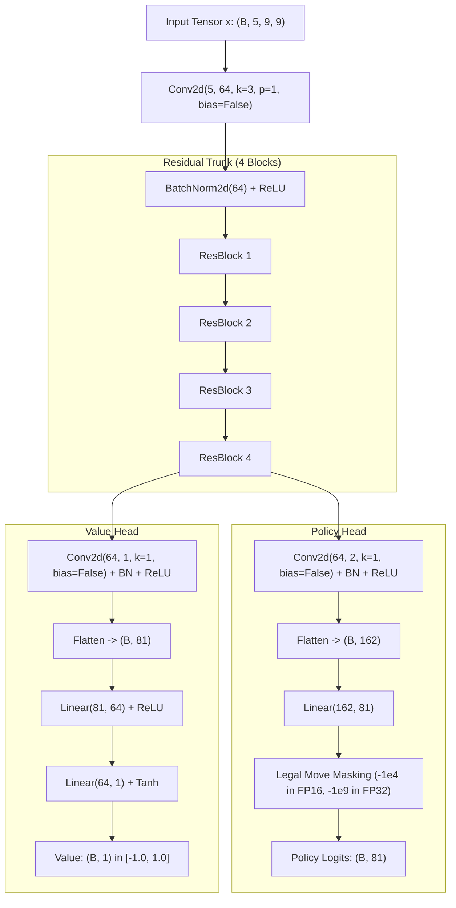

# AlphaZero ResNet Architecture & Implementation Plan

The [`model.py`](file:///home/festivity/agy/uttt-codingame/ml/model.py) module defines the foundational residual convolutional neural network ([`AlphaZeroResNet`](file:///home/festivity/agy/uttt-codingame/ml/model.py#L35-L83)) and associated spatial coordinate transformation utilities for Ultimate Tic-Tac-Toe.

---

## 1. Architectural Plan

The model implements the standard AlphaZero dual-headed architecture tailored to a $9 \times 9$ spatial grid:
- **Shared Residual Trunk**: Processes spatial features through stacked $3 \times 3$ convolutional layers with identity skip connections to capture local 3-in-a-row formations and intermediate subboard states.
- **Policy Head**: Projects trunk activations to a 2-channel $1 \times 1$ convolution before flattening to an 81-dimensional unnormalized logit vector representing move preferences across all board squares.
- **Value Head**: Compresses spatial information via a 1-channel $1 \times 1$ convolution followed by dense layers and a hyperbolic tangent ($\tanh$) activation, predicting expected game outcome in $[-1.0, 1.0]$.

---

## 2. Module Structure & Classes

### Class: [`ResBlock(nn.Module)`](file:///home/festivity/agy/uttt-codingame/ml/model.py#L19-L33)
Standard pre-activation-free residual block with bias-free convolutions and batch normalization:
$$\mathbf{y} = \text{ReLU}\left(\text{BN}_2(\text{Conv}_2(\text{ReLU}(\text{BN}_1(\text{Conv}_1(\mathbf{x}))))) + \mathbf{x}\right)$$
- `channels: int = 64`
- Convolutions: Kernel size $3 \times 3$, padding $1$, stride $1$.

### Class: [`AlphaZeroResNet(nn.Module)`](file:///home/festivity/agy/uttt-codingame/ml/model.py#L35-L83)
Dual-headed network parameterized by:
- `num_channels: int = 64`
- `num_res_blocks: int = 4`

#### Component Layers
- Input Stem: `conv0` (`nn.Conv2d(5, 64, 3, padding=1, bias=False)`), `bn0` (`nn.BatchNorm2d(64)`).
- Trunk: `res_blocks` (`nn.ModuleList` of 4 `ResBlock` instances).
- Policy Head: `conv_p` (`Conv2d(64, 2, 1, bias=False)`), `bn_p` (`BatchNorm2d(2)`), `fc_p` (`Linear(162, 81)`).
- Value Head: `conv_v` (`Conv2d(64, 1, 1, bias=False)`), `bn_v` (`BatchNorm2d(1)`), `fc_v1` (`Linear(81, 64)`), `fc_v2` (`Linear(64, 1)`).

---

## 3. Coordinate Conversion & Board Encoding Helpers

### [`move_index_to_row_col(move_index: int) -> tuple[int, int]`](file:///home/festivity/agy/uttt-codingame/ml/model.py#L86-L93)
Converts flat move index $m \in [0, 80]$ to global 2D grid coordinates $(r, c) \in [0, 8] \times [0, 8]$:
$$r = 3 \cdot \lfloor \lfloor m / 9 \rfloor / 3 \rfloor + \lfloor (m \pmod 9) / 3 \rfloor$$
$$c = 3 \cdot (\lfloor m / 9 \rfloor \pmod 3) + ((m \pmod 9) \pmod 3)$$

### [`row_col_to_move_index(row: int, col: int) -> int`](file:///home/festivity/agy/uttt-codingame/ml/model.py#L95-L100)
Inverts global 2D coordinates back to flat move index:
$$\text{subboard} = 3 \cdot \lfloor r / 3 \rfloor + \lfloor c / 3 \rfloor$$
$$\text{subsquare} = 3 \cdot (r \pmod 3) + (c \pmod 3)$$
$$m = 9 \cdot \text{subboard} + \text{subsquare}$$

### [`encode_board(...) -> tuple[np.ndarray, np.ndarray]`](file:///home/festivity/agy/uttt-codingame/ml/model.py#L102-L183)
Transforms raw bitboard state representations into a `(5, 9, 9)` `float32` tensor and an `(81,)` legal move mask.

#### 5-Channel Representation Layout
- **Channel 0**: Active player's marks on the board.
- **Channel 1**: Opponent player's marks on the board.
- **Channel 2**: Active player's won macro-subboards (broadcast across all 9 cells of won subboards).
- **Channel 3**: Opponent player's won macro-subboards (broadcast across all 9 cells).
- **Channel 4**: Legal target subboard mask (broadcast across all 9 cells of valid target subboards).

---

## 4. Public API Specification

### [`AlphaZeroResNet.forward(x: torch.Tensor, legal_mask: torch.Tensor = None) -> Tuple[torch.Tensor, torch.Tensor]`](file:///home/festivity/agy/uttt-codingame/ml/model.py#L57-L83)

- **Arguments**:
  - `x`: Tensor of shape `(B, 5, 9, 9)` representing input board features.
  - `legal_mask` *(Optional)*: Binary or boolean tensor of shape `(B, 81)` indicating legal actions.
- **Returns**:
  - `p`: Policy logits tensor of shape `(B, 81)`. If `legal_mask` is provided, illegal actions are masked with `-1e4` (FP16) or `-1e9` (FP32).
  - `v`: Value evaluation scalar tensor of shape `(B, 1)` bounded in $[-1.0, 1.0]$.

---

## 5. Verification & Quantization Compatibility

- **Direct INT8 Exportability**:
  - The model uses exclusively standard operations: 2D convolutions, batch normalizations, ReLU, linear layers, and $\tanh$.
  - These primitives directly map to pure Rust SIMD and INT8 quantized implementations in `uttt/src/nn/`.
- **Numerical Precision Adaptation**:
  - Automatically handles FP16 autocasting via dynamic masking constant selection to ensure stable numerical behavior during training.
