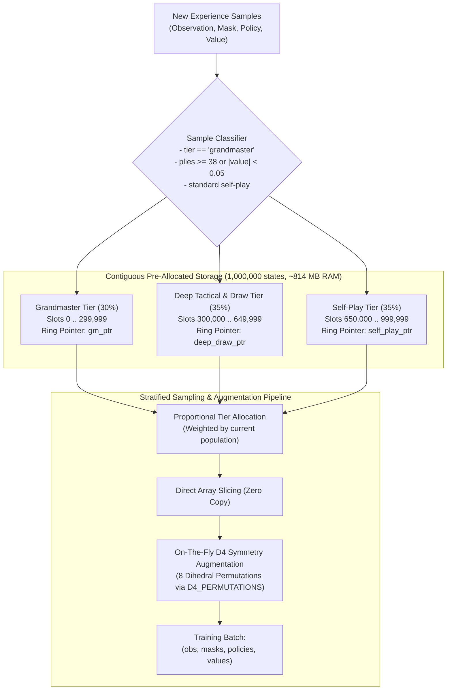

# Replay Buffer Architecture & Implementation Plan

The [`replay_buffer.py`](file:///home/festivity/agy/uttt-codingame/ml/replay_buffer.py) module provides a contiguous, zero-GC stratified replay buffer implementation engineered to store up to 1,000,000 game states in ~814 MB of host RAM. It supports ring-buffer eviction, multi-tier stratification, dynamic D4 dihedral symmetry augmentation, and atomic disk persistence.

---

## 1. Architectural Plan

Key architectural design tenets:
- **Flat Contiguous Memory**: Data arrays are allocated as flat, contiguous NumPy arrays once at construction time. No Python heap objects or node pointers are created per sample.
- **Three-Tier Stratified Partitioning**: Guarantees that valuable grandmaster replays and difficult endgame/draw states are never completely evicted by voluminous short self-play games.
- **Dynamic D4 Dihedral Symmetry Augmentation**: Permutes policies, masks, and spatial observations on-the-fly during sampling using precomputed permutation tables, providing an effective $8\times$ dataset multiplication without additional RAM overhead.

---

## 2. Module Structure & Globals

### Precomputed Dihedral Permutations: `D4_PERMUTATIONS`
Generated by [`_build_d4_permutations()`](file:///home/festivity/agy/uttt-codingame/ml/replay_buffer.py#L25-L42). An `(8, 81)` `int64` lookup table mapping flat move indices $m \in [0, 80]$ through all 8 spatial rotations and reflections:
- 4 orthogonal rotations ($0^\circ, 90^\circ, 180^\circ, 270^\circ$).
- 2 horizontal reflection states (unflipped vs. flipped).

---

## 3. Class Definitions & Memory Layout

### Class: [`ContiguousStratifiedReplayBuffer`](file:///home/festivity/agy/uttt-codingame/ml/replay_buffer.py#L48-L365) *(Alias: `StratifiedReplayBuffer`)*

#### Memory Allocations (for 1,000,000 Capacity)
| Array Name | Data Type | Dimensions | RAM Footprint | Description |
|---|---|---|---|---|
| `observations` | `np.uint8` | `(1_000_000, 5, 9, 9)` | 405 MB | Packed boolean channel bitboards |
| `legal_masks` | `np.uint8` | `(1_000_000, 81)` | 81 MB | Legal move indicator bits |
| `policies` | `np.float32` | `(1_000_000, 81)` | 324 MB | MCTS visit probability distributions |
| `values` | `np.float32` | `(1_000_000, 1)` | 4 MB | Game outcome evaluations |
| **Total** | | | **814 MB** | Contiguous, zero-fragmentation footprint |

#### Tier Offsets & Capacity Partitions
- **Grandmaster (`gm`)**: Starts at index `0`, capacity `int(capacity * 0.30)`.
- **Deep & Draw (`deep_draw`)**: Starts at `gm_capacity`, capacity `int(capacity * 0.35)`.
- **Self-Play (`self_play`)**: Starts at `gm_capacity + deep_draw_capacity`, capacity `capacity - gm_cap - dd_cap`.

---

## 4. Public API Specification

### [`__init__(capacity=1_000_000, gm_ratio=0.30, deep_draw_ratio=0.35, self_play_ratio=0.35)`](file:///home/festivity/agy/uttt-codingame/ml/replay_buffer.py#L49-L84)
Pre-allocates flat NumPy storage arrays, calculates tier slice offsets, and initializes independent ring-buffer pointers and counts.

### [`add_sample(observation, legal_mask, policy, value, game_length=30, tier="self_play")`](file:///home/festivity/agy/uttt-codingame/ml/replay_buffer.py#L97-L159)
Classifies and stores a single experience transition:
1. Compacts float observations/masks into `uint8` storage.
2. Identifies deep/draw games (`game_length >= 38` or $|value| < 0.05$ or `tier in ("deep_draw", "deep_mcts")`).
3. Dispatches into the designated tier ring-buffer. If the target tier is full, it opportunistically fills other non-full tiers before triggering ring-buffer FIFO eviction.

### [`add_samples_batch(observations, legal_masks, policies, values, tier="deep_mcts")`](file:///home/festivity/agy/uttt-codingame/ml/replay_buffer.py#L160-L178)
Iteratively inserts an entire batch of transitions.

### [`sample_batch(batch_size, apply_augmentation=True, augment_d4_prob=1.0) -> Tuple[np.ndarray, np.ndarray, np.ndarray, np.ndarray]`](file:///home/festivity/agy/uttt-codingame/ml/replay_buffer.py#L179-L276)
Samples a stratified batch:
1. Calculates tier batch allocations proportional to current valid populations.
2. Performs fast pseudo-random index sampling into active tier slices.
3. Slices NumPy memory, converting `uint8` observations and masks back to `float32`.
4. Applies on-the-fly D4 dihedral rotation/reflection transformations to observations, legal masks, and policy vectors.

### [`save(filepath: str)`](file:///home/festivity/agy/uttt-codingame/ml/replay_buffer.py#L277-L303)
Serializes buffer contents and metadata (`capacity`, pointers, and counts) to a `.tmp.npz` archive and atomically renames it via `os.replace`.

### [`load(filepath: str) -> bool`](file:///home/festivity/agy/uttt-codingame/ml/replay_buffer.py#L304-L364)
Memory-maps (`mmap_mode="r"`) an on-disk `.npz` archive. Safely handles capacity mismatches between the checkpoint and current configuration by transferring valid slices.

### Class: [`ReplayBufferDataset(torch.utils.data.Dataset)`](file:///home/festivity/agy/uttt-codingame/ml/replay_buffer.py#L371-L389)
Wraps the buffer in standard PyTorch `Dataset` semantics, exposing `__getitem__` and `__len__` for standard `DataLoader` integration.

---

## 5. Verification & Memory Safety

- **Atomic Checkpointing**: Prevents corruption from interruptions during multi-gigabyte disk writes.
- **Population Protection**: Sampling proportions scale with populated tier sizes, preventing IndexError exceptions or zero-sample divisions when beginning training on partially populated buffers.
