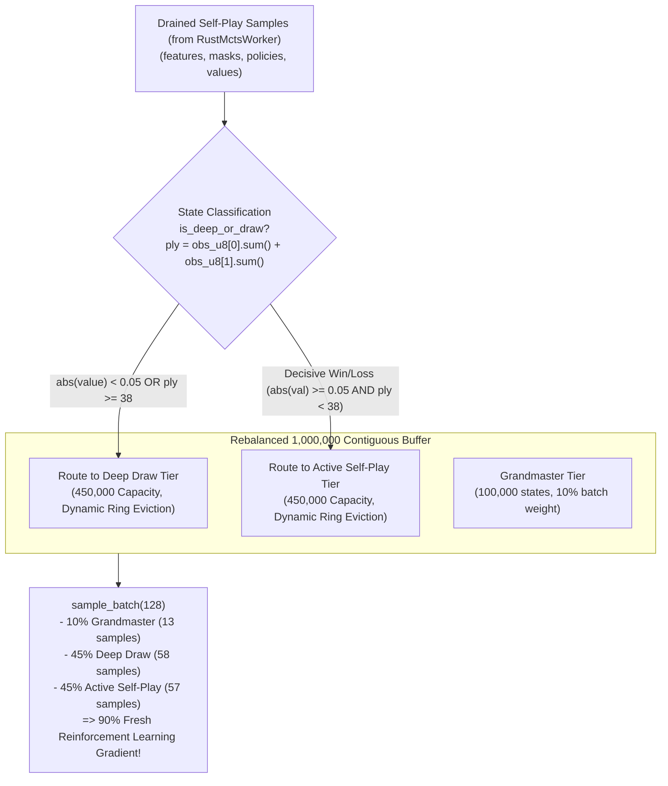

# Replay Buffer Routing & Freshness Architecture & Implementation Plan

This plan specifies the modifications to [`champion_challenger.py`](file:///home/festivity/agy/uttt-codingame/ml/champion_challenger.py) and [`replay_buffer.py`](file:///home/festivity/agy/uttt-codingame/ml/replay_buffer.py) to resolve the `tier="deep_mcts"` routing defect, rebalance capacity allocations, unfreeze stale slices, and maximize policy turnover.

---

## 1. Architectural Plan



---

## 2. Rebalancing Stratum Capacities

The 1,000,000-state contiguous buffer is rebalanced to reduce static anchoring while expanding recent reinforcement learning memory:

| Tier | Previous Capacity | Previous Batch Share | New Capacity | New Batch Share | Purpose |
| :--- | :---: | :---: | :---: | :---: | :--- |
| **Grandmaster (`gm`)** | 300,000 | 30% | **100,000** | **10%** | Baseline strategic foundation without anchor drag |
| **Deep Draw (`deep_draw`)** | 350,000 | 35% | **450,000** | **45%** | High-depth draw defense and endgame resilience |
| **Active Self-Play (`self_play`)** | 350,000 (frozen) | 35% | **450,000** (active) | **45%** | Rapid assimilation of novel winning tactical lines |
| **Total** | 1,000,000 | 100% | **1,000,000** | **100%** | **90% Active Reinforcement Learning Data** |

---

## 3. Code Modifications

### 3.1 Resolving Ingestion in [`ml/champion_challenger.py`](file:///home/festivity/agy/uttt-codingame/ml/champion_challenger.py)
Replace the blanket `tier="deep_mcts"` label with dynamic classification:
```python
# Before (BUGGY):
# replay_buffer.add_samples_batch(f_drain, m_drain, p_drain, v_drain, tier="deep_mcts")

# After (FIXED):
# Pass tier="self_play" and let the buffer route deep draws vs decisive wins naturally
replay_buffer.add_samples_batch(f_drain, m_drain, p_drain, v_drain, tier="self_play")
```

### 3.2 Dynamic Routing & Intrinsic Ply Extraction in [`ml/replay_buffer.py`](file:///home/festivity/agy/uttt-codingame/ml/replay_buffer.py)
In `add_samples_batch`, update the default parameter from `"deep_mcts"` to `"self_play"`:
```python
def add_samples_batch(
    self,
    observations: np.ndarray,
    legal_masks: np.ndarray,
    policies: np.ndarray,
    values: np.ndarray,
    tier: str = "self_play",  # <-- Update default from "deep_mcts" to "self_play"
):
```

In `add_sample`, compute board ply directly from channels 0 and 1 of `observation` (avoiding dependence on the unpassed `game_length` parameter):
```python
# Compute board ply intrinsically from mark count (active + opponent marks)
ply = int(obs_u8[0].sum() + obs_u8[1].sum())

# A sample belongs in deep_draw if it is an explicit draw (abs(val) < 0.05) or deep ply (>= 38)
is_deep_or_draw = (ply >= 38) or (abs(val_f32) < 0.05) or (tier == "deep_draw")

if tier == "grandmaster" and self.gm_capacity > 0:
    slot = self.gm_start + self.gm_ptr
    self.gm_ptr = (self.gm_ptr + 1) % self.gm_capacity
    self.gm_count = min(self.gm_count + 1, self.gm_capacity)
elif is_deep_or_draw:
    slot = self.deep_draw_start + self.deep_draw_ptr
    self.deep_draw_ptr = (self.deep_draw_ptr + 1) % self.deep_draw_capacity
    self.deep_draw_count = min(self.deep_draw_count + 1, self.deep_draw_capacity)
else:
    # Decisive self-play game state
    slot = self.self_play_start + self.self_play_ptr
    self.self_play_ptr = (self.self_play_ptr + 1) % self.self_play_capacity
    self.self_play_count = min(self.self_play_count + 1, self.self_play_capacity)
```

### 3.3 Preserving Constructor Signature & Ratio API
In `ContiguousStratifiedReplayBuffer.__init__`, preserve the existing keyword arguments to avoid breaking existing unit tests or variable-capacity buffers:
```python
def __init__(
    self,
    capacity: int = 1_000_000,
    gm_ratio: float = 0.10,
    deep_draw_ratio: float = 0.45,
    self_play_ratio: float = 0.45,
):
    self.capacity = int(capacity)
    self.gm_capacity = int(capacity * gm_ratio)
    self.deep_draw_capacity = int(capacity * deep_draw_ratio)
    self.self_play_capacity = self.capacity - self.gm_capacity - self.deep_draw_capacity

    self.gm_start = 0
    self.deep_draw_start = self.gm_capacity
    self.self_play_start = self.gm_capacity + self.deep_draw_capacity
```

### 3.4 Checkpoint Tier Capacity Safety in `load()`
In `ContiguousStratifiedReplayBuffer.load()`, verify whether stratum capacities match before performing raw copies:
```python
old_gm_cap = int(meta[1])
old_deep_cap = int(meta[2])
old_sp_cap = int(meta[3])

if (loaded_cap != self.capacity or
    old_gm_cap != self.gm_capacity or
    old_deep_cap != self.deep_draw_capacity or
    old_sp_cap != self.self_play_capacity):
    print(f"Notice: Checkpoint capacities (gm={old_gm_cap:,}, deep={old_deep_cap:,}, sp={old_sp_cap:,}) "
          f"differ from current (gm={self.gm_capacity:,}, deep={self.deep_draw_capacity:,}, sp={self.self_play_capacity:,}). "
          f"Re-ingesting and re-aligning valid slices.")
    
    copy_gm = min(int(meta[5]), self.gm_capacity)
    copy_deep = min(int(meta[7]), self.deep_draw_capacity)
    copy_sp = min(int(meta[9]), self.self_play_capacity)

    old_gm_start = 0
    old_deep_start = old_gm_cap
    old_sp_start = old_gm_cap + old_deep_cap

    if copy_gm > 0:
        self.observations[:copy_gm] = data["observations"][old_gm_start : old_gm_start + copy_gm]
        self.legal_masks[:copy_gm] = data["legal_masks"][old_gm_start : old_gm_start + copy_gm]
        self.policies[:copy_gm] = data["policies"][old_gm_start : old_gm_start + copy_gm]
        self.values[:copy_gm] = data["values"][old_gm_start : old_gm_start + copy_gm]
        self.gm_count = copy_gm
        self.gm_ptr = copy_gm % self.gm_capacity

    if copy_deep > 0:
        self.observations[self.deep_draw_start : self.deep_draw_start + copy_deep] = data["observations"][old_deep_start : old_deep_start + copy_deep]
        self.legal_masks[self.deep_draw_start : self.deep_draw_start + copy_deep] = data["legal_masks"][old_deep_start : old_deep_start + copy_deep]
        self.policies[self.deep_draw_start : self.deep_draw_start + copy_deep] = data["policies"][old_deep_start : old_deep_start + copy_deep]
        self.values[self.deep_draw_start : self.deep_draw_start + copy_deep] = data["values"][old_deep_start : old_deep_start + copy_deep]
        self.deep_draw_count = copy_deep
        self.deep_draw_ptr = copy_deep % self.deep_draw_capacity

    if copy_sp > 0:
        self.observations[self.self_play_start : self.self_play_start + copy_sp] = data["observations"][old_sp_start : old_sp_start + copy_sp]
        self.legal_masks[self.self_play_start : self.self_play_start + copy_sp] = data["legal_masks"][old_sp_start : old_sp_start + copy_sp]
        self.policies[self.self_play_start : self.self_play_start + copy_sp] = data["policies"][old_sp_start : old_sp_start + copy_sp]
        self.values[self.self_play_start : self.self_play_start + copy_sp] = data["values"][old_sp_start : old_sp_start + copy_sp]
        self.self_play_count = copy_sp
        self.self_play_ptr = copy_sp % self.self_play_capacity
else:
    self.observations[:] = data["observations"]
    self.legal_masks[:] = data["legal_masks"]
    self.policies[:] = data["policies"]
    self.values[:] = data["values"]
    self.gm_ptr = int(meta[4])
    self.gm_count = int(meta[5])
    self.deep_draw_ptr = int(meta[6])
    self.deep_draw_count = int(meta[7])
    self.self_play_ptr = int(meta[8])
    self.self_play_count = int(meta[9])
```

---

## 4. Checkpoint Healing & Migration Script (`ml/heal_replay_buffer.py`)

A dedicated migration script will safely salvage active self-play states trapped in `deep_draw`, reduce GM anchor states to 100k, and eliminate the stale legacy slice:

```python
import os
import shutil
import numpy as np

def heal_checkpoint(checkpoint_path: str = "ml/replay_buffer_checkpoint.npz"):
    if not os.path.exists(checkpoint_path):
        print(f"Checkpoint {checkpoint_path} not found.")
        return

    backup_path = checkpoint_path + ".bak"
    shutil.copyfile(checkpoint_path, backup_path)
    print(f"Backed up {checkpoint_path} -> {backup_path}")

    data = np.load(checkpoint_path)
    old_obs = data["observations"]
    old_mask = data["legal_masks"]
    old_pol = data["policies"]
    old_val = data["values"]
    old_meta = data["meta"]

    # Target partition boundaries
    new_gm_cap = 100_000
    new_deep_cap = 450_000
    new_sp_cap = 450_000
    new_cap = 1_000_000

    new_obs = np.zeros_like(old_obs)
    new_mask = np.zeros_like(old_mask)
    new_pol = np.zeros_like(old_pol)
    new_val = np.zeros_like(old_val)

    # 1. Migrate top 100k GM states (from [0 : 100,000])
    new_obs[:new_gm_cap] = old_obs[:new_gm_cap]
    new_mask[:new_gm_cap] = old_mask[:new_gm_cap]
    new_pol[:new_gm_cap] = old_pol[:new_gm_cap]
    new_val[:new_gm_cap] = old_val[:new_gm_cap]
    gm_count = new_gm_cap
    gm_ptr = 0

    # 2. Partition the 350,000 states from old deep_draw slice [300,000 : 650,000]
    dd_obs = old_obs[300_000:650_000]
    dd_mask = old_mask[300_000:650_000]
    dd_pol = old_pol[300_000:650_000]
    dd_val = old_val[300_000:650_000]

    is_draw = np.abs(dd_val.squeeze(1)) < 0.05
    is_decisive = ~is_draw

    draw_indices = np.where(is_draw)[0]
    decisive_indices = np.where(is_decisive)[0]

    n_draw = len(draw_indices)
    n_decisive = len(decisive_indices)
    print(f"Extracted from old deep_draw partition: {n_draw:,} draw states, {n_decisive:,} decisive self-play states.")

    # Populate new deep_draw partition [100,000 : 100,000 + n_draw]
    deep_start = new_gm_cap
    new_obs[deep_start : deep_start + n_draw] = dd_obs[draw_indices]
    new_mask[deep_start : deep_start + n_draw] = dd_mask[draw_indices]
    new_pol[deep_start : deep_start + n_draw] = dd_pol[draw_indices]
    new_val[deep_start : deep_start + n_draw] = dd_val[draw_indices]
    deep_count = n_draw
    deep_ptr = n_draw % new_deep_cap

    # Populate new self_play partition [550,000 : 550,000 + n_decisive]
    sp_start = new_gm_cap + new_deep_cap
    new_obs[sp_start : sp_start + n_decisive] = dd_obs[decisive_indices]
    new_mask[sp_start : sp_start + n_decisive] = dd_mask[decisive_indices]
    new_pol[sp_start : sp_start + n_decisive] = dd_pol[decisive_indices]
    new_val[sp_start : sp_start + n_decisive] = dd_val[decisive_indices]
    sp_count = n_decisive
    sp_ptr = n_decisive % new_sp_cap

    # 3. Old frozen self-play partition [650,000 : 1,000,000] is completely discarded!

    total_inserted = int(old_meta[10])
    new_meta = np.array([
        new_cap,
        new_gm_cap,
        new_deep_cap,
        new_sp_cap,
        gm_ptr,
        gm_count,
        deep_ptr,
        deep_count,
        sp_ptr,
        sp_count,
        total_inserted,
    ], dtype=np.int64)

    temp_path = checkpoint_path + ".tmp.npz"
    np.savez_compressed(
        temp_path,
        observations=new_obs,
        legal_masks=new_mask,
        policies=new_pol,
        values=new_val,
        meta=new_meta,
    )
    os.replace(temp_path, checkpoint_path)
    print(f"Healed checkpoint successfully saved to {checkpoint_path}!")
    print(f"Summary: GM: {gm_count:,}/{new_gm_cap:,} | Deep: {deep_count:,}/{new_deep_cap:,} | SP: {sp_count:,}/{new_sp_cap:,}")

if __name__ == "__main__":
    heal_checkpoint()
```

---

## 5. Verification & Validation Criteria

1. **Pointer Movement Verification**:
   - Run a 1-cycle test of `champion_challenger.py`.
   - Inspect `data["meta"]` in `replay_buffer_checkpoint.npz`.
   - Both `deep_ptr` AND `sp_ptr` must increment dynamically (`sp_ptr > 0`).
2. **Batch Composition Verification**:
   - Sample 10 batches via `sample_batch(128)`.
   - Verify that batches allocate ~10% GM (13 states), ~45% Deep Draw (58 states), ~45% Self-Play (57 states).
3. **Loss Responsiveness**:
   - Verify that Challenger training loss actively responds to fresh reinforcement learning data rather than remaining clamped at $2.62$.
