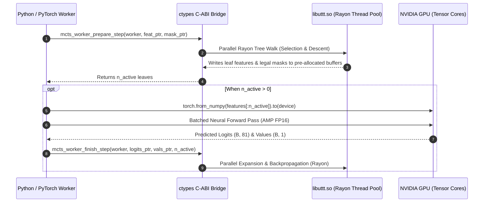

# Rust MCTS Worker Architecture & Implementation Plan

The [`rust_mcts_worker.py`](file:///home/festivity/agy/uttt-codingame/ml/rust_mcts_worker.py) module provides a high-performance `ctypes` foreign function interface (FFI) between Python/PyTorch and the native compiled Rust Rayon MCTS engine (`libuttt.so`). It coordinates lock-free, zero-copy batching across hundreds to thousands of parallel Ultimate Tic-Tac-Toe games to achieve maximal GPU tensor core saturation.

---

## 1. Architectural Plan

The design bifurcates the compute workload:
- **CPU Parallelism (Rust + Rayon)**: High-speed bitboard operations, tree selection, Dirichlet noise injection, node expansion, backpropagation, and game resetting run natively in compiled Rust across CPU cores.
- **GPU Parallelism (PyTorch + CUDA)**: Evaluates large batches of leaf nodes simultaneously, amortizing kernel launch overhead and maximizing tensor core throughput (achieving over 300,000 evals/sec).
- **Zero-Allocation Memory Architecture**: Pre-allocates fixed contiguous NumPy host buffers passed as raw pointers (`ctypes.c_void_p`) to Rust, eliminating per-step memory allocations and Python GC pauses.

---

## 2. Module Structure & C-ABI Bindings

### Class: [`RustMctsWorker`](file:///home/festivity/agy/uttt-codingame/ml/rust_mcts_worker.py#L17-L395)
Encapsulates worker creation, buffer management, simulation execution, and life-cycle destruction.

### Bound C-ABI Functions in `libuttt.so`
- `mcts_worker_create(num_games, c_puct, dirichlet_alpha, dirichlet_eps) -> c_void_p`
- `mcts_worker_destroy(worker) -> None`
- `mcts_worker_reset(worker) -> None`
- `mcts_worker_prepare_step(worker, feat_ptr, mask_ptr) -> c_size_t`
- `mcts_worker_finish_step(worker, logits_ptr, vals_ptr, n_active) -> None`
- `mcts_worker_advance_moves(worker, temperature) -> c_size_t`
- `mcts_worker_advance_moves_tournament(worker, temperature) -> c_size_t`
- `mcts_worker_advance_moves_tournament_recorded(worker, temperature, out_moves) -> c_size_t`
- `mcts_worker_drain_samples(worker, f_ptr, m_ptr, p_ptr, v_ptr, max_count) -> c_size_t`
- `mcts_worker_set_game_moves(worker, game_idx, moves_ptr, len) -> None`
- `mcts_worker_get_game_status(worker, game_idx) -> c_int32`
- `mcts_worker_get_game_x_to_move(worker, game_idx) -> c_bool`
- `mcts_worker_get_active_indices(worker, act_idx_ptr, max_len) -> c_size_t`
- `mcts_worker_apply_moves_batch(worker, idx_ptr, mv_ptr, len) -> None`
- `alphabeta_batch_choose_moves(flat_moves, offsets, lengths, n_games, time_ms, out_moves) -> None`
- `alphabeta_v1_batch_choose_moves(...)` and `umcts_v2_batch_choose_moves(...)` (dynamically bound if present).

---

## 3. Data Structures & Buffer Layout

Upon instantiation, the worker allocates contiguous memory layouts for zero-copy host exchange:

| Buffer Name | Data Type | Dimensions | Description |
|---|---|---|---|
| `features_buffer` | `np.float32` | `(num_games, 5, 9, 9)` | 5-channel spatial bitboard inputs |
| `masks_buffer` | `np.float32` | `(num_games, 81)` | Binary legal move masks (1.0 = legal) |
| `logits_buffer` | `np.float32` | `(num_games, 81)` | Raw network policy logits returned from GPU |
| `values_buffer` | `np.float32` | `(num_games,)` | Scalar position value evaluations in $[-1, 1]$ |
| `active_indices_buffer` | `np.uintp` | `(num_games,)` | Indices of game trees with pending leaf evaluations |

---

## 4. Public API Specification

### [`__init__(num_games=1024, c_puct=2.0, dirichlet_alpha=0.3, dirichlet_eps=0.25, so_path=None)`](file:///home/festivity/agy/uttt-codingame/ml/rust_mcts_worker.py#L18-L64)
Locates `target/release/libuttt.so`, loads the library via `ctypes.CDLL`, binds FFI function types, initializes the native Rayon worker instance, and pre-allocates contiguous NumPy memory.

### [`step_simulation(model, device="cuda") -> int`](file:///home/festivity/agy/uttt-codingame/ml/rust_mcts_worker.py#L164-L189)
Executes one synchronized parallel tree descent and GPU leaf evaluation cycle across all active games. Returns count of evaluated leaves.

### [`run_mcts_search(model, num_simulations=800, device="cuda") -> int`](file:///home/festivity/agy/uttt-codingame/ml/rust_mcts_worker.py#L190-L201)
Repeats `step_simulation` for `num_simulations` iterations, returning the total cumulative leaf evaluations performed.

### [`advance_moves(temperature=1.0) -> int`](file:///home/festivity/agy/uttt-codingame/ml/rust_mcts_worker.py#L202-L211)
Advances one ply in self-play mode: samples next moves from visit count distributions parameterized by `temperature`, appends finished trajectories to internal sample queues, and automatically resets terminated games. Returns count of generated training samples.

### [`advance_moves_tournament(temperature=0.0) -> int`](file:///home/festivity/agy/uttt-codingame/ml/rust_mcts_worker.py#L260-L265) & [`advance_moves_tournament_recorded(temperature=0.0) -> Tuple[int, np.ndarray]`](file:///home/festivity/agy/uttt-codingame/ml/rust_mcts_worker.py#L266-L278)
Advances moves without resetting terminated games. The recorded variant returns the number of completed games and an array of chosen move indices (or `255` for inactive/finished slots).

### [`step_simulation_dual(model_chal, model_champ, game_to_model, device="cuda") -> int`](file:///home/festivity/agy/uttt-codingame/ml/rust_mcts_worker.py#L279-L316)
Evaluates a single MCTS simulation step across two competing neural architectures simultaneously, partitioning active leaf indices according to boolean indicator array `game_to_model`.

### [`drain_samples(max_count=50_000) -> Tuple[np.ndarray, np.ndarray, np.ndarray, np.ndarray]`](file:///home/festivity/agy/uttt-codingame/ml/rust_mcts_worker.py#L212-L234)
Extracts completed game records from Rust queues into fresh NumPy arrays `(features, masks, policies, values)`.

### [`apply_moves_batch(game_indices: List[int], moves: List[int])`](file:///home/festivity/agy/uttt-codingame/ml/rust_mcts_worker.py#L317-L334)
Applies a batch of external move decisions directly to specified game slots.

### [`choose_alphabeta_moves(game_history_list, time_limit_ms=10, bot_version="v2") -> List[int]`](file:///home/festivity/agy/uttt-codingame/ml/rust_mcts_worker.py#L335-L395)
Dispatches a batch of game move histories to native Rust AlphaBeta search threads running with transposition tables and iterative deepening.

---

## 5. Verification & Memory Safety

- **Native Resource Management**: Implements `__del__` to invoke `mcts_worker_destroy(self.worker)`, preventing heap leaks in the foreign Rust runtime.
- **Pointer Lifetime Assurance**: Buffer pointers (`feat_ptr`, etc.) refer to NumPy arrays permanently bound to `self`, preventing premature garbage collection or dangling memory references during FFI calls.
- **Asynchronous Host-to-Device Transfers**: Employs `non_blocking=True` when transferring NumPy arrays to PyTorch GPU tensors, overlapping host-to-device PCI-e transfers with CPU preparation.
