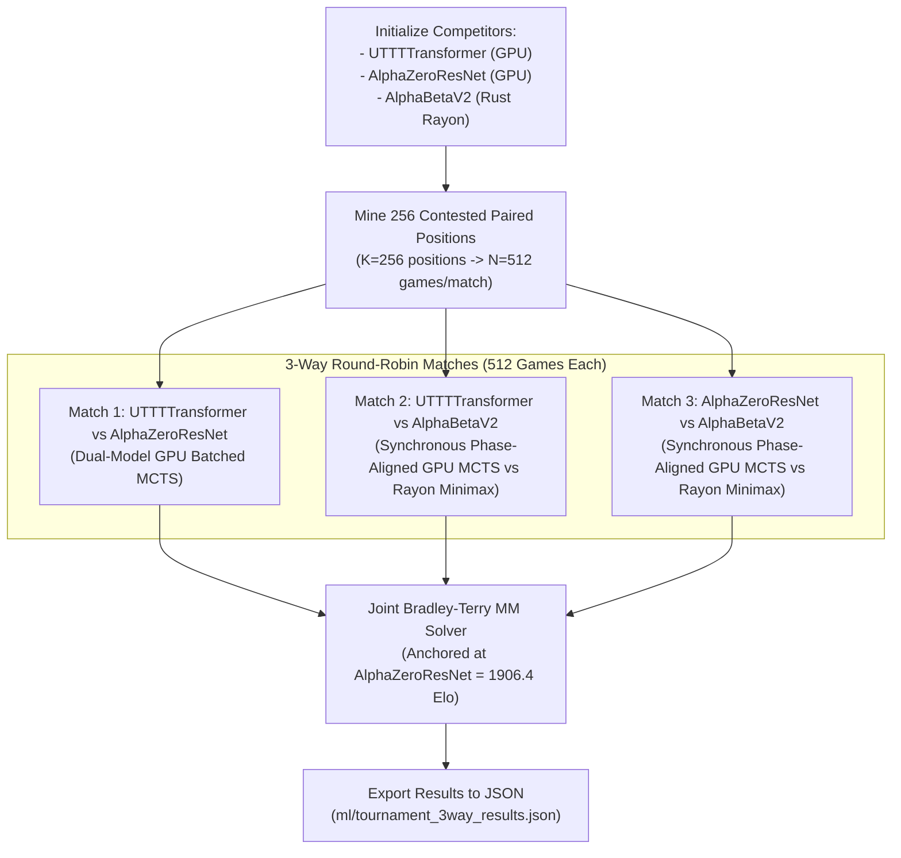

# 3-Way Tournament Architecture & Implementation Plan

The [`tournament_3way.py`](file:///home/festivity/agy/uttt-codingame/ml/tournament_3way.py) module orchestrates a rigorous round-robin tournament across the three primary Ultimate Tic-Tac-Toe architectures:
1. **`UTTTTransformer`** (Gen-8 Champion, Vision Transformer)
2. **`AlphaZeroResNet`** (Gen-7 Champion, Residual CNN)
3. **`AlphaBetaV2`** (Pure Rust Minimax Engine with transposition tables, killer heuristics, and DF-PN)

It evaluates 512 balanced mirrored games (256 paired positions) per pairing, eliminating positional and color bias while achieving full hardware saturation across GPU and multi-core CPU.

---

## 1. Architectural Plan

Key architectural features:
- **Balanced Mirrored Openings**: Each mined tactical position $P_k$ is played in two games: Game $2k$ (Model A starts from $P_k$) and Game $2k+1$ (Model B starts from $P_k$).
- **Dual-Model GPU Batching**: In neural-vs-neural matches, active leaf evaluations for both networks are batched into a single MCTS iteration.
- **Phase-Aligned Neural vs. AlphaBeta Execution**: Odd games have AlphaBeta play the first move at ply 0, aligning all 512 games so the neural net and minimax search execute in alternating synchronous batches without pipeline stalls.
- **Joint Bradley-Terry Maximum Likelihood Rating**: Combines all pairwise outcomes into statistically consistent Elo ratings anchored to a known reference standard.

---

## 2. Module Structure & Data Classes

### Data Class: [`MatchResult`](file:///home/festivity/agy/uttt-codingame/ml/tournament_3way.py#L40-L56)
Encapsulates all statistical observations from a 512-game paired match:
- `competitor_a: str`, `competitor_b: str`
- `total_games: int`, `total_pairs: int`
- `a_wins: int`, `b_wins: int`, `draws: int`
- `a_double_wins: int` (games where A won both sides of the paired position, 2-0)
- `b_double_wins: int` (games where B won both sides, 0-2)
- `symmetrical_splits: int` (games where each won one side, 1-1)
- `a_win_rate: float`, `margin_of_error: float` (95% confidence interval)
- `delta_elo: float`, `elapsed_seconds: float`

---

## 3. Public API & Core Functions

### [`solve_bradley_terry(...) -> Dict[str, float]`](file:///home/festivity/agy/uttt-codingame/ml/tournament_3way.py#L58-L111)
Computes joint maximum-likelihood skill parameters using the iterative Minorization-Maximization (MM) algorithm:
- Constructs win matrix $W_{ij} = \text{wins}_{ij} + 0.5 \cdot \text{draws}_{ij}$.
- Iteratively updates skill parameters:
  $$p_i^{(t+1)} = \frac{\sum_j W_{ij}}{\sum_{j \neq i} \frac{W_{ij} + W_{ji}}{p_i^{(t)} + p_j^{(t)}}}$$
- Normalizes geometric mean to $1.0$ and converts to Elo relative to the anchor:
  $$\text{Elo}_i = \text{anchor\_elo} + 400 \cdot \log_{10}\left(\frac{p_i}{p_{\text{anchor}}}\right)$$

### [`run_neural_vs_neural_match(...) -> MatchResult`](file:///home/festivity/agy/uttt-codingame/ml/tournament_3way.py#L114-L227)
Executes a 512-game match between two neural models (e.g. Transformer vs. ResNet):
- Initializes [`RustMctsWorker`](file:///home/festivity/agy/uttt-codingame/ml/rust_mcts_worker.py#L17-L395) with `num_games=512`, `dirichlet_eps=0.0`.
- Maps active players each ply and calls `step_simulation_dual`.
- Advances moves deterministically with `temperature=0.0`.
- Computes pairwise score metrics and double-win frequencies.

### [`run_neural_vs_alphabeta_match(...) -> MatchResult`](file:///home/festivity/agy/uttt-codingame/ml/tournament_3way.py#L229-L364)
Executes a 512-game match between a Neural Model and the native Rust AlphaBeta minimax engine:
- Pre-aligns odd games ($2i+1$) with a preliminary AlphaBeta move.
- Synchronizes execution into two alternating phases per ply:
  - **Neural Phase**: Runs GPU MCTS simulations across all games where it is the neural model's turn, advances moves, and records chosen moves.
  - **AlphaBeta Phase**: Dispatches active game move histories to the Rust Rayon minimax thread pool via `choose_alphabeta_moves(active_histories, time_limit_ms=10)` and applies moves via `apply_moves_batch`.

### [`main()`](file:///home/festivity/agy/uttt-codingame/ml/tournament_3way.py#L367-L536)
CLI entrypoint:
- Loads model checkpoints (`champion.pt` for Transformer, `champion_gen7_resnet.pt` for ResNet).
- Mines 256 high-divergence paired positions using [`mine_interesting_positions`](file:///home/festivity/agy/uttt-codingame/ml/parallel_mirror_eval.py).
- Executes the 3 pairwise matches.
- Solves joint Bradley-Terry ratings anchored at `AlphaZeroResNet = 1906.4`.
- Outputs formatted leaderboard and persists payload to `tournament_3way_results.json`.

---

## 4. Verification & Statistical Guarantees

- **Confidence Intervals**: Computes 95% margin of error:
  $$\text{MOE} = 1.96 \cdot \sqrt{\frac{\hat{p}(1 - \hat{p})}{N}}$$
- **Symmetry Isolation**: Tracks double-wins (2-0, 0-2) versus symmetrical splits (1-1), proving that model superiority is independent of opening favorability.
