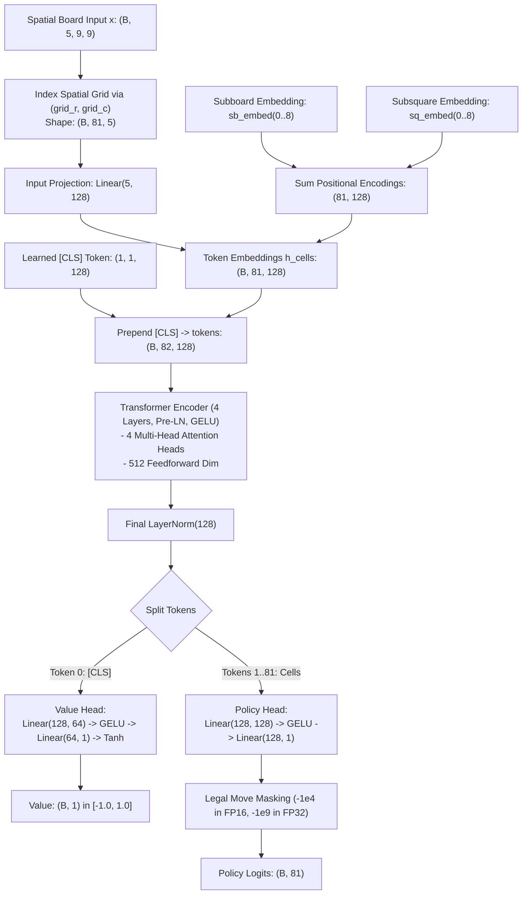

# UTTT Transformer Architecture & Implementation Plan

The [`transformer_model.py`](file:///home/festivity/agy/uttt-codingame/ml/transformer_model.py) module defines [`UTTTTransformer`](file:///home/festivity/agy/uttt-codingame/ml/transformer_model.py#L22-L139), a dedicated vision/board transformer architecture engineered for Ultimate Tic-Tac-Toe. It models the full $9 \times 9$ board as a compact sequence of 81 spatial cell tokens plus a dedicated `[CLS]` token for game outcome prediction.

---

## 1. Architectural Plan



The model architecture replaces standard 2D convolutional inductive bias with global multi-head self-attention:
- **Global Receptive Field**: Directly couples actions in subboard $B$ to forced routing destinations in subboard $B'$ in Layer 1.
- **Decomposed Positional Encodings**: Disentangles the macro-board coordinate ($0..8$) from the micro-square destination ($0..8$).
- **Dual Policy & Value Heads**: Dispatches move evaluations directly from contextualized cell tokens, while routing state evaluation through the prepended `[CLS]` token.

---

## 2. Module Structure & Buffers

### Class: [`UTTTTransformer(nn.Module)`](file:///home/festivity/agy/uttt-codingame/ml/transformer_model.py#L22-L139)

#### Configuration Hyperparameters
- `d_model: int = 128` (hidden token dimension)
- `nhead: int = 4` (number of self-attention heads)
- `num_layers: int = 4` (transformer encoder depth)
- `dim_feedforward: int = 512` (inner feedforward expansion dimension)
- `dropout: float = 0.0` (deterministic training without dropout)

#### Precomputed Registered Buffers
The constructor precomputes bijective coordinate transformations between flat move index $m \in [0, 80]$ and $2\text{D}$ board coordinates $(r, c)$, storing them as persistent PyTorch buffers:
- `grid_r`: Row coordinate in $[0, 8]$ for move $m$.
- `grid_c`: Column coordinate in $[0, 8]$ for move $m$.
- `subboard_ids`: Subboard index $\lfloor m / 9 \rfloor \in [0, 8]$.
- `subsquare_ids`: Subsquare index $(m \pmod 9) \in [0, 8]$.

---

## 3. Sub-layer Specifications

1. **Input Projection & Embeddings**:
   - `input_proj`: `nn.Linear(5, 128)` projects the 5 raw feature channels to token dimension.
   - `sb_embed`: `nn.Embedding(9, 128)` encodes the macro subboard origin.
   - `sq_embed`: `nn.Embedding(9, 128)` encodes the intra-subboard cell position (which also dictates the opponent's forced subboard destination).
   - `cls_token`: `nn.Parameter` initialized from $\mathcal{N}(0, 0.02^2)$ with shape `(1, 1, 128)`.

2. **Encoder Trunk**:
   - 4-layer [`nn.TransformerEncoder`](https://pytorch.org/docs/stable/generated/torch.nn.TransformerEncoder.html) utilizing Pre-LN (`norm_first=True`), GELU activations, and `batch_first=True`.
   - `enable_nested_tensor=False` ensures compatibility with torch scripting and static compilation.
   - Post-encoder `nn.LayerNorm(128)` stabilizes representations before head projection.

3. **Policy Head**:
   - Multi-layer perceptron acting independently on each of the 81 contextualized cell tokens:
     $$\text{Linear}(128, 128) \rightarrow \text{GELU} \rightarrow \text{Linear}(128, 1)$$
   - Squeezed to yield output shape `(B, 81)`.

4. **Value Head**:
   - Evaluates the terminal state scalar from the contextualized `[CLS]` token:
     $$\text{Linear}(128, 64) \rightarrow \text{GELU} \rightarrow \text{Linear}(64, 1) \rightarrow \text{Tanh}$$
   - Yields output shape `(B, 1)` bounded in $[-1.0, 1.0]$.

---

## 4. Public API & Forward Contract

### [`forward(x: torch.Tensor, legal_mask: torch.Tensor = None) -> Tuple[torch.Tensor, torch.Tensor]`](file:///home/festivity/agy/uttt-codingame/ml/transformer_model.py#L97-L138)

- **Inputs**:
  - `x`: Board feature tensor of shape `(B, 5, 9, 9)`.
  - `legal_mask` *(Optional)*: Binary or boolean tensor of shape `(B, 81)` indicating legal moves.
- **Outputs**:
  - `logits`: Tensor of shape `(B, 81)`. Illegal moves are masked out.
  - `value`: Scalar position evaluation tensor of shape `(B, 1)` in $[-1.0, 1.0]$.

---

## 5. Verification & Numerical Precision

- **Mixed Precision Support (AMP)**:
  - Dynamically detects tensor dtype during legal move masking:
    ```python
    fill_val = -1e4 if logits.dtype == torch.float16 else -1e9
    ```
  - Using `-1e4` under FP16 prevents underflow to `-inf` and `NaN` propagation during `F.log_softmax` cross-entropy training.
- **Cache Locality**:
  - Sequence length $L = 82$ requires modest memory bandwidth, fitting comfortably inside GPU L1/L2 caches.
